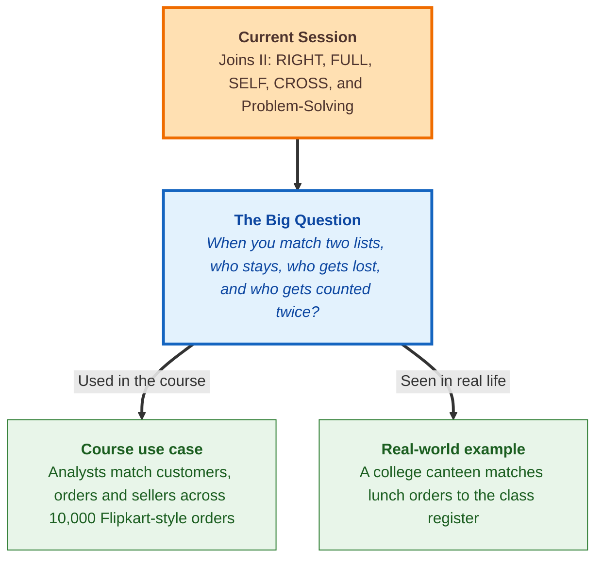

## <span style="color:#2F7DDE">Joins II: RIGHT, FULL, SELF, CROSS, and Problem-Solving</span>

### <span style="color:#2F7DDE">Mental Map</span>



---

### <span style="color:#2F7DDE">What You'll Learn</span>

Have you ever wondered how a canteen knows who ate lunch and who skipped it?

By the end of this session, you will be able to:

- <span style="color:#D9660B">**Identify**</span> what you get when 5 students are paired with 5 menu items.
- <span style="color:#D9660B">**Explain**</span> when to keep every order, or every student, without a match.
- <span style="color:#D9660B">**Determine**</span> each student's study buddy using only the class register.
- <span style="color:#D9660B">**Solve**</span> lunch questions that need the register and the orders together.
- <span style="color:#D9660B">**Check**</span> a combined list that drops Riya or counts Aman twice, then fix it.
- <span style="color:#D9660B">**Write**</span> steps that keep all 5 students and all 5 orders.

> <span style="color:#2F7DDE">**Topics you will meet:**</span> RIGHT JOIN, FULL OUTER JOIN, SELF JOIN, CROSS JOIN, row-count checks, and multi-table problems.
>
> Join the session to learn each of these in detail.

---

### <span style="color:#2F7DDE">Why You Are Learning This Topic</span>

It is lunch break at your college canteen. The counter keeps a list of today's orders. Your teacher keeps a class register of 5 students. Neha from another class ordered idli too. Riya and Kabir skipped lunch.

To see who ate what, you line up the two lists. A <span style="color:#D9660B">**join**</span> means matching rows from two tables using a detail they share, like a student's name.

In your course, you will match customers, orders and sellers in the same way.

> <span style="color:#2F7DDE">**Think about it:**</span> When you line up the lists, who stays and who quietly disappears?

---

### <span style="color:#2F7DDE">The Canteen Lunch Puzzle</span>

The register lists Aman, Riya, Kabir, Sana and Dev. Each student has a study buddy from the same register. Here are today's canteen orders.

| Order | Student | Item | Price (rupees) |
|:-----:|:-------:|:----:|:--------------:|
| 1 | Aman | Samosa | 20 |
| 2 | Aman | Juice | 30 |
| 3 | Sana | Dosa | 50 |
| 4 | Dev | Sandwich | 40 |
| 5 | Neha | Idli | 35 |

<span style="color:#D9660B">**What you want to happen:**</span>

- Keep every order on the list, even Neha's.
- Keep every student, even Riya and Kabir, who ordered nothing.
- Count 5 students, not 6, after you match the lists.

Here is how it might start. You do not need to understand it yet.

```sql
SELECT r.name, o.item
FROM register r
RIGHT JOIN orders o ON r.name = o.student;
```

> <span style="color:#D9660B">**Wonder about this:**</span>
>
> - Why does Aman show up twice when you match the two lists?
> - If you pair every student with every menu item, how long is the list?

---

### <span style="color:#2F7DDE">Think It Through</span>

There is no wrong first try. Keep your guesses for the session.

**1. Who goes missing if you keep only students who placed an order?**
Hint: Look for register names missing from the orders.

**2. How would you show each student next to their study buddy's name?**
Hint: The buddy's name sits in the same register.

**3. Your count says 6 students, but the register has 5. Where did the extra one come from?**
Hint: Count the orders next to each name.

---

### <span style="color:#2F7DDE">One Question to Carry Into the Session</span>

> <span style="color:#2F7DDE">**How do you combine two lists so nobody is lost and nobody is counted twice?**</span>
>
> And how would you check the result first?
