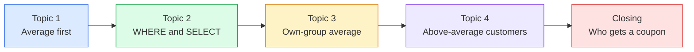
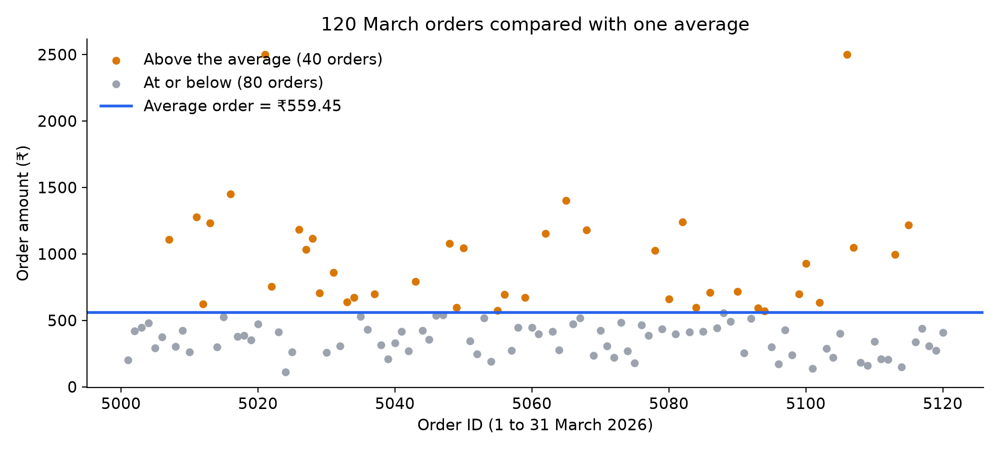
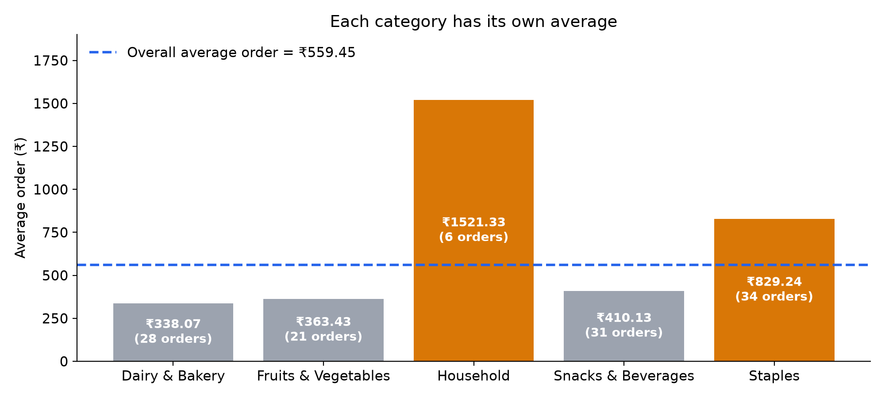
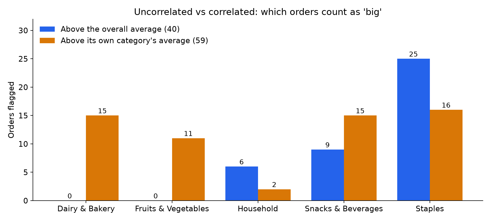
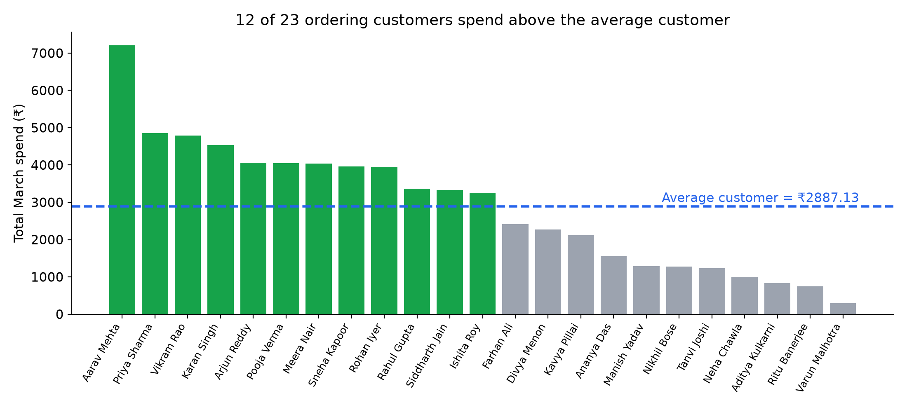
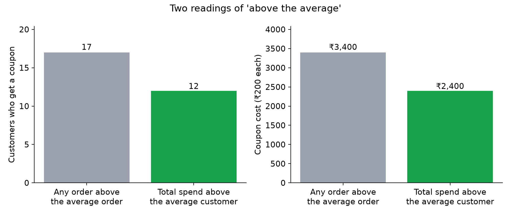

# <font color='#1d4ed8'>Lecture Script: Subqueries (MySQL)</font>

---

## <font color='blue'>Agenda</font>

The lecture runs as four topics. Each topic ends with a quiz.

| Topic | What we do | Learning objectives covered | Minutes |
|:-:|:--|:--|:-:|
| 1 | Work out the average first | Write a subquery to compute an intermediate result | 22 |
| 2 | Put subqueries in WHERE and SELECT | Use subqueries in WHERE and in the SELECT list | 30 |
| 3 | Compare each order with its own group | Distinguish a correlated from an uncorrelated subquery, by example | 30 |
| 4 | Find the above-average customers | Answer a question such as customers who spend above the average | 26 |
| — | Closing: Outcome & Summary | | 12 |
| | **Total** | | **120** |

> <font color="red">**🎯 Instructor Note**</font> Pace: keep Topic 1 brisk, since learners already know `AVG`. Spend the time on the `NOT IN` trap in Topic 2 and the row-by-row idea in Topic 3.
> Let learners run every query; the outputs below come from MySQL 8.0.

---

## <font color='blue'>Scenario</font>

It is the last day of March at a BigBasket-style grocery app. The marketing team wants to thank its best shoppers with a ₹200 coupon each. The analyst has two tables: `customers` (25 people) and `orders` (120 March orders across five categories). Three orders were guest checkouts with no customer, and two customers signed up but never ordered.

> <font color="red">**🎯 Instructor Note**</font> BigBasket is only the setting. Do not claim BigBasket uses this data; `data/bigbasket_orders.sql` is invented for teaching.
> Learners load it once in MySQL 8.0 or later and use `grocery_demo`. Treat 31 March 2026 as "today".

---

## <font color='blue'>Problem Statement</font>

The brief said: "Send the coupon to customers who spend above the average." The analyst found the average order, ₹559.45, and picked every customer with any order above it. That gave 17 customers and ₹3,400 of coupons.

Next week, finance asked why Manish Yadav got a coupon. He spent ₹1,286 in the whole month. Five of the 17 coupons, ₹1,000, went to people who are not above-average spenders.

> <font color='purple'>**Which customers really spend above the average, and how do we find them in one query that stays correct when new orders arrive?**</font>

> <font color="red">**🎯 Instructor Note**</font> Poll: "Farhan Ali has two orders above the ₹559.45 average order. Is he an above-average spender?" Give learners 30 seconds to respond in chat. Reveal the answer in the Closing.

---

## <font color='blue'>What We Will Use</font>

One new idea, a query inside another query, used in four ways. Each tool is explained when we first use it.

| Topic | Tools | In one line |
|:-:|:--|:--|
| 1 | `( SELECT AVG(...) )`, `MAX` | work out one number first, then use it |
| 2 | `IN`, `NOT IN`, `IS NOT NULL`, a subquery in the `SELECT` list | match against a list, add a column from another query |
| 3 | table aliases `o1` and `o2`, correlated subquery | compare each row with its own group |
| 4 | `JOIN`, `GROUP BY`, `HAVING`, `COUNT(DISTINCT ...)` | total each customer and compare with the average customer |

---

## <font color='blue'>How: Walking Through the Coupon List</font>



---

## <font color='blue'>Topic 1: Work Out the Average First</font> `22 min`

> <font color='purple'>**Every "above the average" question needs one number before anything else. How do we get it without typing it in by hand?**</font>

In Aggregations and GROUP BY you used `AVG` to summarise a column. Today that answer becomes an input to a second query.

### <font color='green'>Example: orders above the average order</font>

> <font color='purple'>**How many March orders are bigger than the average order?**</font>

First, run the inner question on its own.

**Predict before running: What will happen?**

> <font color="red">**🎯 Instructor Note**</font> Expected: one row, one number. Common guess: learners expect a whole number because every amount is whole.

```sql
SELECT AVG(amount) AS avg_order
FROM orders;
```

**Output**

```
+-----------+
| avg_order |
+-----------+
|  559.4500 |
+-----------+
```

Now place that query, in brackets, where the number would go.

**Predict before running: What will happen?**

> <font color="red">**🎯 Instructor Note**</font> Ask for a guess out of 120. Expected: 40, because a few large Staples and Household orders pull the average up.

```sql
SELECT COUNT(*) AS above_avg_orders
FROM orders
WHERE amount > (SELECT AVG(amount) FROM orders);
```

**Output**

```
+------------------+
| above_avg_orders |
+------------------+
|               40 |
+------------------+
```

#### <font color='#c2410c'>Code Explanation</font>

- **Line 1** Counts the rows that pass the filter and names the count.
- **Line 2** Reads from `orders`.
- **Line 3** The part in brackets is a **subquery**. MySQL works it out first (₹559.45), then keeps each order whose amount is greater.

> <font color='green'>**Result**</font> 40 of the 120 orders are above the ₹559.45 average order. The average is recalculated every time the query runs, so new orders never leave a stale number behind.

<p align="center"></p>

### <font color='green'>Extending it: the biggest order, with a tie</font>

> <font color='purple'>**Which order is the biggest of the month?**</font>

> <font color="red">**🎯 Instructor Note**</font> Ask: "`ORDER BY amount DESC LIMIT 1` or a subquery, does it matter?" Give learners 30 seconds to respond in chat. Expected: it matters when there is a tie.

```sql
SELECT order_id, customer_id, category, amount
FROM orders
WHERE amount = (SELECT MAX(amount) FROM orders)
ORDER BY order_id;
```

**Output**

```
+----------+-------------+-----------+--------+
| order_id | customer_id | category  | amount |
+----------+-------------+-----------+--------+
|     5021 |           5 | Household |   2499 |
|     5106 |           1 | Household |   2499 |
+----------+-------------+-----------+--------+
```

```sql
SELECT order_id, customer_id, category, amount
FROM orders
ORDER BY amount DESC
LIMIT 1;
```

**Output**

```
+----------+-------------+-----------+--------+
| order_id | customer_id | category  | amount |
+----------+-------------+-----------+--------+
|     5021 |           5 | Household |   2499 |
+----------+-------------+-----------+--------+
```

#### <font color='#c2410c'>Code Explanation</font>

- **First query, line 3** The subquery finds the largest amount (₹2,499) and the outer query keeps every order equal to it.
- **Second query, lines 3 and 4** Sorts from biggest to smallest and keeps only the first row.

> <font color='green'>**Result**</font> Two orders tie at ₹2,499. The subquery returns both; `LIMIT 1` silently drops order 5106 and Aarav Mehta with it.

> <font color='#b45309'>**Common mistake**</font> Using `LIMIT 1` for "the biggest". When ties are possible, compare with `(SELECT MAX(...))` instead.

### <font color='purple'>Quiz 1</font>

**Question:** You run `SELECT AVG(amount) FROM orders;`, get 559.4500, and type `WHERE amount > 559.45` into your next query. Next week 30 new orders are added. What does that next query do?

**Options:**
- A) It updates to the new average on its own
- B) It still compares with 559.45, so its answer can be wrong without any warning
- C) MySQL stops with an error because the number is out of date
- D) It returns zero rows until you rerun the first query

**Correct Answer:** B

**Explanation:**
- **A)** Wrong: a typed number never changes; only a subquery recalculates.
- **B)** Correct: the typed value stays 559.45 while the true average moves, and nothing warns you.
- **C)** Wrong: MySQL has no idea where the number came from, so there is no error.
- **D)** Wrong: it still returns the orders above 559.45; the rows are just judged against an old average.

---

## <font color='blue'>Topic 2: Put Subqueries in WHERE and SELECT</font> `30 min`

> <font color='purple'>**Topic 1's subquery returned one number. What if the inner question returns a list of customers instead?**</font>

In Filtering: WHERE and Operators you used `IN` with a typed list and `IS NULL` for missing values. Both come back here.

### <font color='green'>Example: customers who bought Household items</font>

> <font color='purple'>**Which customers have ever placed a Household order?**</font>

**Predict before running: What will happen?**

> <font color="red">**🎯 Instructor Note**</font> Expected: 6 names, one per Household order. Common guess: learners try `=` and expect it to work with a list.

```sql
SELECT customer_id, customer_name
FROM customers
WHERE customer_id IN (SELECT customer_id
                      FROM orders
                      WHERE category = 'Household')
ORDER BY customer_id;
```

**Output**

```
+-------------+---------------+
| customer_id | customer_name |
+-------------+---------------+
|           1 | Aarav Mehta   |
|           2 | Priya Sharma  |
|           5 | Vikram Rao    |
|           9 | Arjun Reddy   |
|          14 | Pooja Verma   |
|          17 | Farhan Ali    |
+-------------+---------------+
```

#### <font color='#c2410c'>Code Explanation</font>

- **Lines 1 and 2** Show the id and name from `customers`.
- **Lines 3 to 5** The subquery lists every `customer_id` with a Household order. `IN` keeps a customer whose id is anywhere in that list.
- **Line 6** Sorts by id so the order never changes.

> <font color='green'>**Result**</font> Six customers bought Household items. The names live in `customers` and the categories in `orders`; the subquery links them without a join.

### <font color='green'>Extending it: customers who never ordered</font>

> <font color='purple'>**Which customers have no orders at all?**</font>

> <font color="red">**🎯 Instructor Note**</font> Ask for a prediction. Expected by most learners: Zoya Khan and Harsh Patel. Let the empty result surprise them.

```sql
SELECT customer_id, customer_name
FROM customers
WHERE customer_id NOT IN (SELECT customer_id FROM orders)
ORDER BY customer_id;
```

**Output**

```
Empty set (0.00 sec)
```

#### <font color='#c2410c'>Logic Explanation</font>

- The inner list holds three `NULL`s from the guest checkouts.
- `NOT IN` asks "is 24 different from every value in the list?" Compared with `NULL`, the answer is unknown, never yes. So no customer passes, and MySQL shows no error.

```sql
SELECT customer_id, customer_name
FROM customers
WHERE customer_id NOT IN (SELECT customer_id
                          FROM orders
                          WHERE customer_id IS NOT NULL)
ORDER BY customer_id;
```

**Output**

```
+-------------+---------------+
| customer_id | customer_name |
+-------------+---------------+
|          24 | Zoya Khan     |
|          25 | Harsh Patel   |
+-------------+---------------+
```

#### <font color='#c2410c'>Code Explanation</font>

- **Line 5** `IS NOT NULL` removes the guest orders from the inner list before `NOT IN` compares against it.

> <font color='green'>**Result**</font> Zoya Khan and Harsh Patel have never ordered. The first query was wrong in the worst way: an empty answer with no error.

> <font color='#b45309'>**Common mistake**</font> `NOT IN` with a subquery that can return `NULL`. Always add `WHERE column IS NOT NULL` inside it.

### <font color='green'>Extending it: a subquery in the SELECT list</font>

> <font color='purple'>**How far is each order from the average order?**</font>

> <font color="red">**🎯 Instructor Note**</font> Ask what the `avg_order` column will look like row by row. Expected: the same 559.45 on every row.

```sql
SELECT order_id, category, amount,
       ROUND((SELECT AVG(amount) FROM orders), 2) AS avg_order,
       ROUND(amount - (SELECT AVG(amount) FROM orders), 2) AS gap
FROM orders
ORDER BY order_id
LIMIT 5;
```

**Output**

```
+----------+---------------------+--------+-----------+---------+
| order_id | category            | amount | avg_order | gap     |
+----------+---------------------+--------+-----------+---------+
|     5001 | Fruits & Vegetables |    202 |    559.45 | -357.45 |
|     5002 | Fruits & Vegetables |    421 |    559.45 | -138.45 |
|     5003 | Fruits & Vegetables |    446 |    559.45 | -113.45 |
|     5004 | Staples             |    481 |    559.45 |  -78.45 |
|     5005 | Dairy & Bakery      |    292 |    559.45 | -267.45 |
+----------+---------------------+--------+-----------+---------+
```

#### <font color='#c2410c'>Code Explanation</font>

- **Line 2** A subquery in the `SELECT` list adds a column; it must return exactly one value.
- **Line 3** The same subquery inside arithmetic gives the gap; negative means below the average.
- **Lines 5 and 6** Sort by id and show the first five orders.

> <font color='green'>**Result**</font> Each row now carries the overall average next to its own amount, so the gap can be read directly.

### <font color='green'>Extending it: when the inner query returns too many rows</font>

> <font color='purple'>**What happens if a subquery used with `=` returns more than one value?**</font>

> <font color="red">**🎯 Instructor Note**</font> Ask: "Equal to which Household order?" Expected: an error, because there are six.

```sql
SELECT order_id, amount
FROM orders
WHERE amount = (SELECT amount FROM orders WHERE category = 'Household');
```

**Output**

```
ERROR 1242 (21000) at line 1: Subquery returns more than 1 row
```

#### <font color='#c2410c'>Code Explanation</font>

- **Line 3** `=` needs one value, but the subquery returns six Household amounts, so MySQL stops.

> <font color='green'>**Result**</font> With `=`, `>` or `<`, the subquery must return one value. For a list, use `IN`; for one value, wrap the column in `MAX`, `MIN` or `AVG`.

### <font color='purple'>Quiz 2</font>

**Question:** `orders` has three rows with a `NULL` `customer_id`. What does this return?
`SELECT customer_name FROM customers WHERE customer_id NOT IN (SELECT customer_id FROM orders);`

**Options:**
- A) Zoya Khan and Harsh Patel
- B) All 25 customers
- C) Every customer who placed at least one order
- D) No rows

**Correct Answer:** D

**Explanation:**
- **A)** Wrong: this is the intended answer, but it needs `WHERE customer_id IS NOT NULL` inside the subquery.
- **B)** Wrong: no customer can pass a `NOT IN` test against a list that holds `NULL`.
- **C)** Wrong: that would be `IN`, not `NOT IN`.
- **D)** Correct: the `NULL` in the list makes every `NOT IN` comparison unknown, so nothing is returned.

---

## <font color='blue'>Topic 3: Compare Each Order with Its Own Group</font> `30 min`

> <font color='purple'>**Is a ₹600 Staples order big? Is a ₹480 Dairy order big? Should both be judged against the same ₹559.45?**</font>

In Joins II you joined a table to itself by giving it two aliases. A correlated subquery uses the same trick: `o1` is the outer copy of `orders` and `o2` the inner copy.

<p align="center"></p>

### <font color='green'>Example: Household orders above the Household average</font>

> <font color='purple'>**Which Household orders are bigger than the average Household order?**</font>

**Predict before running: What will happen?**

> <font color="red">**🎯 Instructor Note**</font> All 6 Household orders beat the overall ₹559.45. Expected here: only 2, because the Household average is ₹1,521.33.

```sql
SELECT o1.order_id, o1.category, o1.amount
FROM orders o1
WHERE o1.amount > (SELECT AVG(o2.amount)
                   FROM orders o2
                   WHERE o2.category = o1.category)
  AND o1.category = 'Household'
ORDER BY o1.amount DESC, o1.order_id;
```

**Output**

```
+----------+-----------+--------+
| order_id | category  | amount |
+----------+-----------+--------+
|     5021 | Household |   2499 |
|     5106 | Household |   2499 |
+----------+-----------+--------+
```

#### <font color='#c2410c'>Code Explanation</font>

- **Lines 1 and 2** Read `orders` under the alias `o1`, the row being judged.
- **Lines 3 to 5** The subquery reads a second copy, `o2`, and averages only the orders in the same category as the current `o1` row. Because it uses `o1.category`, it is **correlated**.
- **Line 6** Keeps the example to Household so the output is short.
- **Line 7** Sorts by amount, then by id to break the tie.

#### <font color='#c2410c'>Logic Explanation</font>

- Think of the subquery running again for each outer row. For order 5016 (₹1,450), it averages the six Household orders, ₹1,521.33, and 1,450 is not above it.
- For order 5021 (₹2,499), the same average applies and 2,499 is above it. An uncorrelated subquery would compare every row with the one overall number instead.

> <font color='green'>**Result**</font> Only the two ₹2,499 orders are big for Household. Measured against the overall average, all six looked big.

### <font color='green'>Extending it: the quick test</font>

> <font color='purple'>**How can you tell, by looking, whether a subquery is correlated?**</font>

> <font color="red">**🎯 Instructor Note**</font> Have learners select only the inner part of the last query and run it. Expected: an error.

```sql
SELECT AVG(o2.amount)
FROM orders o2
WHERE o2.category = o1.category;
```

**Output**

```
ERROR 1054 (42S22) at line 1: Unknown column 'o1.category' in 'where clause'
```

#### <font color='#c2410c'>Code Explanation</font>

- **Line 3** `o1` exists only in the outer query, so on its own this part has nothing to compare with.

> <font color='green'>**Result**</font> If the inner part runs on its own, the subquery is uncorrelated. If it needs a value from the outer row, it is correlated.

### <font color='green'>Extending it: both answers side by side</font>

> <font color='purple'>**Across all five categories, how many orders count as big under each rule?**</font>

> <font color="red">**🎯 Instructor Note**</font> Ask which categories will show zero under the overall rule. Expected: Dairy & Bakery and Fruits & Vegetables.

```sql
SELECT o1.category,
       SUM(o1.amount > (SELECT AVG(amount) FROM orders)) AS above_overall,
       SUM(o1.amount > (SELECT AVG(o2.amount)
                        FROM orders o2
                        WHERE o2.category = o1.category)) AS above_own_category
FROM orders o1
GROUP BY o1.category
ORDER BY o1.category;
```

**Output**

```
+---------------------+---------------+--------------------+
| category            | above_overall | above_own_category |
+---------------------+---------------+--------------------+
| Dairy & Bakery      |             0 |                 15 |
| Fruits & Vegetables |             0 |                 11 |
| Household           |             6 |                  2 |
| Snacks & Beverages  |             9 |                 15 |
| Staples             |            25 |                 16 |
+---------------------+---------------+--------------------+
```

#### <font color='#c2410c'>Code Explanation</font>

- **Line 2** In MySQL a comparison gives 1 when true and 0 when false, so `SUM` of it counts the true rows. This one is uncorrelated.
- **Lines 3 to 5** The same count, but against each row's own category average. This one is correlated.
- **Lines 7 and 8** One row per category, sorted by name.

> <font color='green'>**Result**</font> The overall rule flags 40 orders, mostly Staples and Household. The own-category rule flags 59, spread across every category. Neither is wrong; they answer different questions.

<p align="center"></p>

### <font color='green'>Extending it: a correlated subquery in the SELECT list</font>

> <font color='purple'>**How many orders has each customer placed, including customers with none?**</font>

> <font color="red">**🎯 Instructor Note**</font> Ask what Zoya Khan's row will show. Expected: 0, not a missing row.

```sql
SELECT c.customer_id, c.customer_name,
       (SELECT COUNT(*)
        FROM orders o
        WHERE o.customer_id = c.customer_id) AS orders_placed
FROM customers c
WHERE c.customer_id >= 21
ORDER BY c.customer_id;
```

**Output**

```
+-------------+----------------+---------------+
| customer_id | customer_name  | orders_placed |
+-------------+----------------+---------------+
|          21 | Manish Yadav   |             2 |
|          22 | Ritu Banerjee  |             2 |
|          23 | Varun Malhotra |             1 |
|          24 | Zoya Khan      |             0 |
|          25 | Harsh Patel    |             0 |
+-------------+----------------+---------------+
```

#### <font color='#c2410c'>Code Explanation</font>

- **Lines 2 to 4** For each customer row `c`, the subquery counts that customer's orders; it uses `c.customer_id`, so it is correlated.
- **Line 6** Shows the last five customers to keep the output short.

> <font color='green'>**Result**</font> Every customer keeps a row, and the two who never ordered show 0.

### <font color='purple'>Quiz 3</font>

**Question:** Which of these subqueries is correlated?

**Options:**
- A) `(SELECT COUNT(*) FROM orders o WHERE o.customer_id = c.customer_id)`
- B) `(SELECT AVG(amount) FROM orders)`
- C) `(SELECT customer_id FROM orders WHERE category = 'Household')`
- D) `(SELECT MAX(amount) FROM orders WHERE category = 'Staples')`

**Correct Answer:** A

**Explanation:**
- **A)** Correct: it uses `c.customer_id` from the outer query, so it cannot run on its own.
- **B)** Wrong: it runs on its own and gives one number for the whole query.
- **C)** Wrong: it runs on its own and gives one fixed list.
- **D)** Wrong: the filter is a fixed value, `'Staples'`, not a column from the outer row.

---

## <font color='blue'>Topic 4: Find the Above-Average Customers</font> `26 min`

> <font color='purple'>**Back to the coupon: what does "customers who spend above the average" mean, and which customers qualify?**</font>

In Refining Groups with HAVING you filtered grouped totals. The comparison value now comes from a subquery.

### <font color='green'>Example: total spend against the average customer</font>

> <font color='purple'>**What is each customer's March total, and what does the average customer spend?**</font>

**Predict before running: What will happen?**

> <font color="red">**🎯 Instructor Note**</font> Expected: Aarav Mehta on top with ₹7,205. Remind learners that guest orders are left out with `IS NOT NULL`.

```sql
SELECT customer_id, SUM(amount) AS total_spend
FROM orders
WHERE customer_id IS NOT NULL
GROUP BY customer_id
ORDER BY total_spend DESC, customer_id
LIMIT 5;
```

**Output**

```
+-------------+-------------+
| customer_id | total_spend |
+-------------+-------------+
|           1 |        7205 |
|           2 |        4853 |
|           5 |        4790 |
|           7 |        4539 |
|           9 |        4057 |
+-------------+-------------+
```

```sql
SELECT SUM(amount) / COUNT(DISTINCT customer_id) AS avg_customer_spend
FROM orders
WHERE customer_id IS NOT NULL;
```

**Output**

```
+--------------------+
| avg_customer_spend |
+--------------------+
|          2887.1304 |
+--------------------+
```

#### <font color='#c2410c'>Code Explanation</font>

- **First query** Totals each customer's orders, biggest first, with the id as a tie-breaker.
- **Second query, line 1** All customer spending (₹66,404) divided by the number of customers who ordered (23).
- **Second query, line 3** Leaves out the guest orders, which belong to no customer.

> <font color='green'>**Result**</font> The average customer spends ₹2,887.13 in March. That, not the ₹559.45 average order, is the bar for "spends above the average".

### <font color='green'>Extending it: one query for the whole list</font>

> <font color='purple'>**Which customers have a total above ₹2,887.13, in one query?**</font>

> <font color="red">**🎯 Instructor Note**</font> Ask why the filter goes in `HAVING`, not `WHERE`. Expected: the total exists only after `GROUP BY`.

```sql
SELECT c.customer_name, SUM(o.amount) AS total_spend
FROM customers c
JOIN orders o ON o.customer_id = c.customer_id
GROUP BY c.customer_id, c.customer_name
HAVING SUM(o.amount) > (SELECT SUM(amount) / COUNT(DISTINCT customer_id)
                        FROM orders
                        WHERE customer_id IS NOT NULL)
ORDER BY total_spend DESC, c.customer_id;
```

**Output**

```
+----------------+-------------+
| customer_name  | total_spend |
+----------------+-------------+
| Aarav Mehta    |        7205 |
| Priya Sharma   |        4853 |
| Vikram Rao     |        4790 |
| Karan Singh    |        4539 |
| Arjun Reddy    |        4057 |
| Pooja Verma    |        4053 |
| Meera Nair     |        4039 |
| Sneha Kapoor   |        3958 |
| Rohan Iyer     |        3951 |
| Rahul Gupta    |        3359 |
| Siddharth Jain |        3332 |
| Ishita Roy     |        3255 |
+----------------+-------------+
```

#### <font color='#c2410c'>Code Explanation</font>

- **Lines 2 and 3** Join each order to its customer to get the name.
- **Line 4** One group per customer.
- **Lines 5 to 7** Keep a group only if its total beats the average customer, worked out by the subquery from the Example.
- **Line 8** Biggest spender first, id as the tie-breaker.

> <font color='green'>**Result**</font> 12 customers spend above the average customer. Farhan Ali (₹2,409) is not one of them.

<p align="center"></p>

### <font color='green'>Extending it: the reading that went wrong</font>

> <font color='purple'>**How many customers did the analyst's first reading pick?**</font>

> <font color="red">**🎯 Instructor Note**</font> Ask for a guess before running. Expected: 17, five more than the correct 12.

```sql
SELECT COUNT(DISTINCT customer_id) AS customers
FROM orders
WHERE customer_id IS NOT NULL
  AND amount > (SELECT AVG(amount) FROM orders);
```

**Output**

```
+-----------+
| customers |
+-----------+
|        17 |
+-----------+
```

#### <font color='#c2410c'>Logic Explanation</font>

- This counts customers with any single order above ₹559.45. One large order is enough, even if the month's total is small.
- The five extra customers are Farhan Ali, Divya Menon, Kavya Pillai, Manish Yadav and Nikhil Bose. Each has one or two big orders but a total below ₹2,887.13.

> <font color='green'>**Result**</font> Before writing any SQL, decide what "the average" is the average of: orders or customers. The two readings give 17 and 12 customers.

### <font color='purple'>Quiz 4</font>

**Question:** Marketing now wants Zoya Khan and Harsh Patel (₹0 each) counted when working out the average, so the average customer spend becomes ₹2,656.16. How many customers spend above it?

**Options:**
- A) 14
- B) 13
- C) 12
- D) 25

**Correct Answer:** C

**Explanation:**
- **A)** Wrong: no customer sits between ₹2,656.16 and ₹2,887.13, so the list cannot grow by two.
- **B)** Wrong: the closest candidate, Farhan Ali with ₹2,409, is still below ₹2,656.16.
- **C)** Correct: the bar drops, but the same 12 customers are above it and the next one is below it.
- **D)** Wrong: 25 is everyone, including the two who spent nothing.

---

## <font color='blue'>Closing: Outcome & Summary</font> `12 min`

Back to the problem: send the ₹200 coupon only to customers who really spend above the average. We use each topic once.

> <font color='purple'>**1. What single number did the analyst compare against?**</font>

The average order, ₹559.45, worked out by a subquery (Topic 1). It answers a question about orders, not about customers.

> <font color='purple'>**2. Who can never qualify?**</font>

Zoya Khan and Harsh Patel have no orders. The `NOT IN` query only found them once the guest checkouts' `NULL`s were removed (Topic 2).

> <font color='purple'>**3. Is "big" the same for every group?**</font>

No. Against its own category, an order can be big or small regardless of the overall average; that is the correlated subquery (Topic 3).

> <font color='purple'>**4. How many customers get the coupon, and what does it cost?**</font>

```sql
SELECT COUNT(*) AS customers, COUNT(*) * 200 AS coupon_cost
FROM customers c
WHERE (SELECT SUM(o.amount)
       FROM orders o
       WHERE o.customer_id = c.customer_id)
      > (SELECT SUM(amount) / COUNT(DISTINCT customer_id)
         FROM orders
         WHERE customer_id IS NOT NULL);
```

**Output**

```
+-----------+-------------+
| customers | coupon_cost |
+-----------+-------------+
|        12 |        2400 |
+-----------+-------------+
```

#### <font color='#c2410c'>Code Explanation</font>

- **Line 1** Counts the qualifying customers and multiplies by ₹200.
- **Lines 3 to 5** A correlated subquery totals each customer's orders (Topic 3).
- **Lines 6 to 8** An uncorrelated subquery gives the average customer spend, the intermediate result (Topics 1 and 4).

<p align="center"></p>

### <font color='green'>Outcome</font>

| | Any order above the average order | Total spend above the average customer |
|:--|:-:|:-:|
| Compared with | ₹559.45 per order | ₹2,887.13 per customer |
| Customers who get a coupon | 17 | 12 |
| Coupon cost | ₹3,400 | ₹2,400 |
| Farhan Ali included? | Yes | No |

> <font color='green'>**Therefore,**</font> the coupon goes to the 12 customers whose March total beats the average customer, for ₹2,400. The first reading would have spent ₹1,000 more on five customers who are not above-average spenders. Because the average lives in a subquery, the same query stays correct as April's orders arrive.

> <font color="red">**🎯 Instructor Note**</font> Reveal the poll: Farhan Ali has two big orders, but his total of ₹2,409 is below ₹2,887.13, so he is not an above-average spender.

### <font color='green'>Summary</font>

| Learning objective | Takeaway |
|:--|:--|
| Intermediate result | A subquery in brackets works out a value first, such as `(SELECT AVG(amount) FROM orders)`; run it alone to check it |
| WHERE and SELECT list | With `=` or `>` it must return one value; with `IN` a list; in `SELECT` it adds a column; filter `NULL` out before `NOT IN` |
| Correlated vs uncorrelated | Uncorrelated runs on its own and gives one answer; correlated uses a column from the outer row and is worked out per row |
| Customers above the average | Decide "average of what" first, then total per customer and compare in `HAVING` with a subquery |
| **Practical value** | One self-updating query replaces copy-pasted numbers and stops money going to the wrong list |

---

# <font color='red'>Launch the Feedback Poll</font>

> <font color="red">**🎯 Instructor Note**</font> Reminder: launch the feedback poll now to collect learner feedback.
