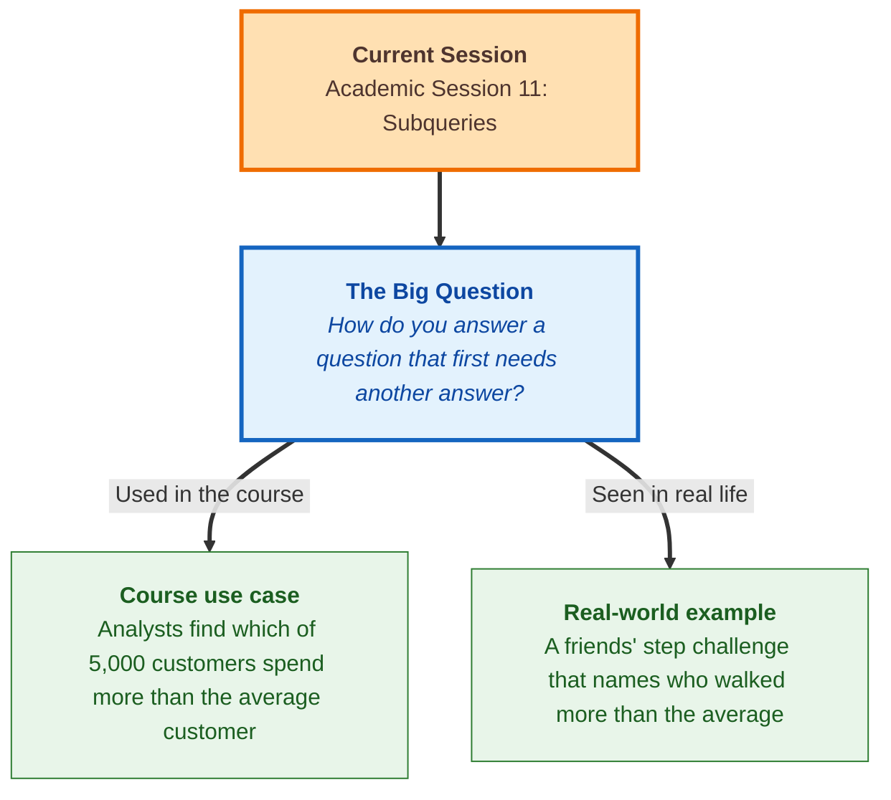

## <span style="color:#2F7DDE">Academic Session 11: Subqueries</span>

### <span style="color:#2F7DDE">Mental Map</span>



---

### <span style="color:#2F7DDE">What You'll Learn</span>

Have you ever wondered how a fitness app knows you walked more than your friends did on average?

By the end of this session, you will be able to:

- <span style="color:#D9660B">**Calculate**</span> the average of 5 friends' steps as a first step inside a bigger question.
- <span style="color:#D9660B">**Use**</span> that average to list each friend who walked more than it.
- <span style="color:#D9660B">**Demonstrate**</span> how to show each friend's steps beside the group average.
- <span style="color:#D9660B">**Differentiate**</span> a comparison with the whole group from one with each friend's own team.
- <span style="color:#D9660B">**Write**</span> one request that finds the friends who beat their own team's average.

> <span style="color:#2F7DDE">**Topics you will meet:**</span> subqueries, subqueries in WHERE and in the SELECT list, and correlated and uncorrelated subqueries.
>
> Join the session to learn each of these in detail.

---

### <span style="color:#2F7DDE">Why You Are Learning This Topic</span>

Your friends run a step challenge in a group chat. Each evening, everyone shares their step count. Someone asks who walked more than the average. You cannot answer until you know the average. So you ask a small question first, then the big one.

A <span style="color:#D9660B">**subquery**</span> means a question inside another question, whose answer the bigger question uses.

In your course, you will use the same idea to find customers who spend above the average.

> <span style="color:#2F7DDE">**Think about it:**</span> What small question must you answer before you can name the winners?

---

### <span style="color:#2F7DDE">The Step Challenge Puzzle</span>

Here are yesterday's step counts. The 5 friends play in two teams, Red and Blue.

| Friend | Team | Steps |
|:------:|:----:|:-----:|
| Ishaan | Red | 7,000 |
| Tara | Red | 5,000 |
| Nikhil | Blue | 9,000 |
| Pooja | Blue | 12,000 |
| Farhan | Blue | 6,000 |

<span style="color:#D9660B">**What you want to happen:**</span>

- Find the average steps for all 5 friends first.
- List every friend who walked more than that average.
- Show each friend's steps next to the group average.

Here is how it might start. You do not need to understand it yet.

```sql
SELECT friend, steps
FROM challenge
WHERE steps > (SELECT AVG(steps) FROM challenge);
```

> <span style="color:#D9660B">**Wonder about this:**</span>
>
> - Is Ishaan a winner if you compare him only with his own team?
> - Why might the winners change when each team gets its own average?

---

### <span style="color:#2F7DDE">Think It Through</span>

There is no wrong first try. Keep your guesses for the session.

**1. What is the average number of steps for all 5 friends?**
Hint: Add the 5 numbers, then divide by 5.

**2. Which friends walked more than that average?**
Hint: Compare each row with the number from question 1.

**3. Does the list change if each friend is compared only with their own team?**
Hint: Find the Red average and the Blue average first.

---

### <span style="color:#2F7DDE">One Question to Carry Into the Session</span>

> <span style="color:#2F7DDE">**How can one question use the answer to another, smaller question?**</span>
>
> And what changes when the smaller question is asked again for each friend?
