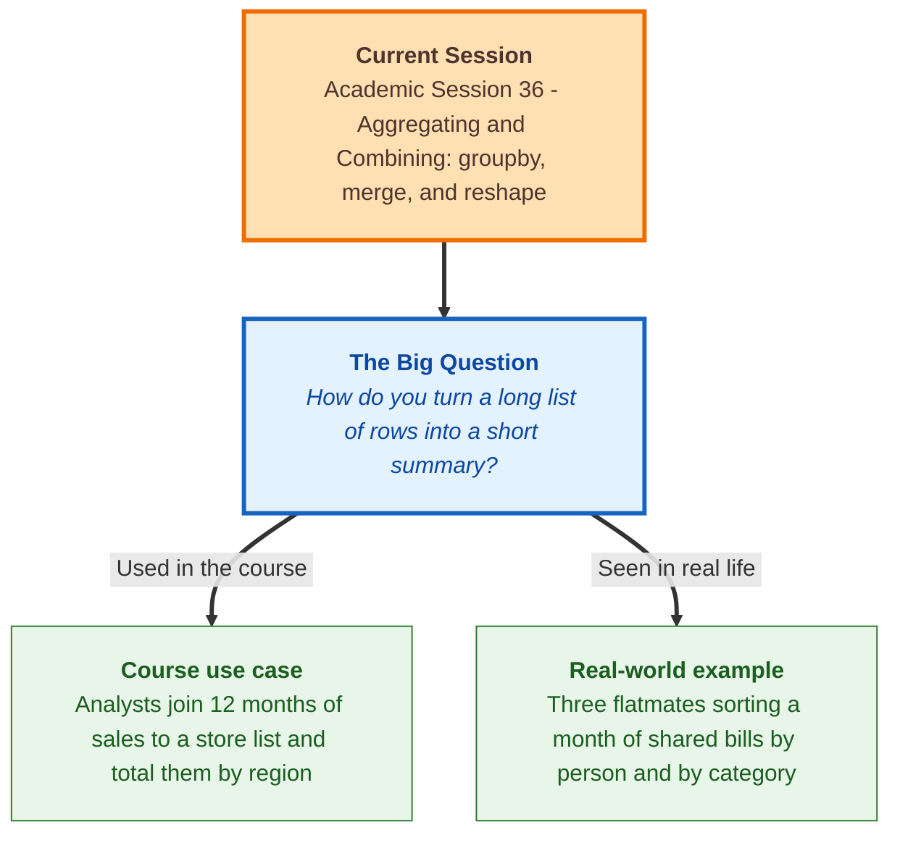

## <span style="color:#2F7DDE">Academic Session 36 - Aggregating and Combining: groupby, merge, and reshape</span>

### <span style="color:#2F7DDE">Mental Map</span>



---

### <span style="color:#2F7DDE">What You'll Learn</span>

Have you ever wondered how a bill-splitting app knows who owes what at the end of the month?

By the end of this session, you will be able to:

- <span style="color:#D9660B">**Identify**</span> the column that links a list of purchases to a list of flatmate names.
- <span style="color:#D9660B">**Use**</span> that link to put each flatmate's name beside every purchase they made.
- <span style="color:#D9660B">**Calculate**</span> the total spend for each of 3 categories, such as ₹1,250 on groceries.
- <span style="color:#D9660B">**Compare**</span> one long list of purchases with a grid of flatmates by category.
- <span style="color:#D9660B">**Design**</span> a one-page monthly report that shows spend by category and by flatmate.

> <span style="color:#2F7DDE">**Topics you will meet:**</span> groupby, merge as a mirror of SQL joins, pivot_table and melt, and summarising data by category.
>
> Join the session to learn each of these in detail.

---

### <span style="color:#2F7DDE">Why You Are Learning This Topic</span>

You share a flat with two friends. Each of you pays for groceries, electricity or internet when needed. Every purchase goes into one shared list. At month end, the list has 30 rows and nobody knows who paid what. You need totals, not rows.

<span style="color:#D9660B">**Grouping**</span> means putting rows with the same label together, then summarising each group with one number.

In your course, you will summarise real datasets by category in the same way for reports.

> <span style="color:#2F7DDE">**Think about it:**</span> Would you rather read 30 purchase rows or one row per category?

---

### <span style="color:#2F7DDE">The Flat Expenses Puzzle</span>

Here are the first 6 purchases. A second list matches IDs to names: 101 is Kabir, 102 is Meher, 103 is Arjun.

| Flatmate ID | Category | Amount (₹) |
|:-----------:|:--------:|:----------:|
| 101 | Groceries | 600 |
| 102 | Groceries | 400 |
| 101 | Electricity | 900 |
| 103 | Internet | 500 |
| 102 | Electricity | 300 |
| 103 | Groceries | 250 |

<span style="color:#D9660B">**What you want to happen:**</span>

- Show each flatmate's name beside their purchases.
- Total the spend for each category.
- Lay it out as a grid, with flatmates as rows and categories as columns.

Here is how it might start. You do not need to understand it yet.

```python
spend = purchases.merge(flatmates, on="flatmate_id")
spend.groupby("category")["amount"].sum()
```

> <span style="color:#D9660B">**Wonder about this:**</span>
>
> - What happens to a purchase whose ID is missing from the names list?
> - Should the monthly report be one long list or a grid?

---

### <span style="color:#2F7DDE">Think It Through</span>

There is no wrong first try. Keep your guesses for the session.

**1. What is the total spend on groceries?**
Hint: Add the amount on every Groceries row.

**2. Which flatmate spent the most money this month?**
Hint: Match each ID to a name first, then add up each person's rows.

**3. What would a grid of flatmates and categories look like?**
Hint: Draw one cell for each flatmate and category. A cell can stay empty.

---

### <span style="color:#2F7DDE">One Question to Carry Into the Session</span>

> <span style="color:#2F7DDE">**How do you join two lists and then shrink them into one summary?**</span>
>
> And when is a grid easier to read than a long list?
