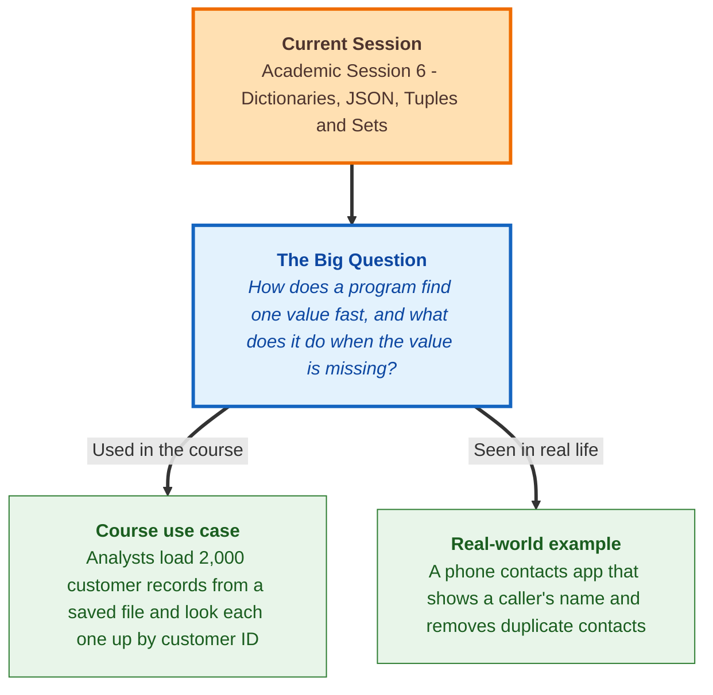

## <span style="color:#2F7DDE">Academic Session 6 - Dictionaries, JSON, Tuples and Sets</span>

### <span style="color:#2F7DDE">Mental Map</span>



---

### <span style="color:#2F7DDE">What You'll Learn</span>

Have you ever wondered how your phone shows a friend's name the moment they call?

By the end of this session, you will be able to:

- <span style="color:#D9660B">**Classify**</span> each entry in a contacts backup file as text, a number, true or false, or empty.
- <span style="color:#D9660B">**Use**</span> a friend's name to find their phone number in a saved list.
- <span style="color:#D9660B">**Determine**</span> what to show when a number is not saved, such as "Unknown caller".
- <span style="color:#D9660B">**Check**</span> whether a number is already saved before you add it again.
- <span style="color:#D9660B">**Write**</span> a birthday as one fixed pair, then split it into a day and a month.
- <span style="color:#D9660B">**Build**</span> a contact list with every repeated name removed.

> <span style="color:#2F7DDE">**Topics you will meet:**</span> dictionaries and get, the in operator, tuples and unpacking, sets, and JSON.
>
> Join the session to learn each of these in detail.

---

### <span style="color:#2F7DDE">Why You Are Learning This Topic</span>

You buy a new phone and restore your contacts from a backup. Meera now appears twice. A call comes from a number you never saved. The screen shows "Unknown caller" and keeps working.

Your phone finds names faster than you can scroll. A <span style="color:#D9660B">**dictionary**</span> means a collection of pairs, where a name finds its value, like a friend's number.

In your course, you will look up customer details the same way, by an ID instead of a name.

> <span style="color:#2F7DDE">**Think about it:**</span> How does the phone know a number is not in your contacts?

---

### <span style="color:#2F7DDE">The Phone Contacts Puzzle</span>

Here are your contacts right after the restore. Each birthday is stored as a fixed pair, like (14, "March").

| Name | Number | Birthday |
|:----:|:------:|:--------:|
| Meera | 98110 24567 | 14 March |
| Arjun | 98730 11842 | 2 July |
| Meera | 98110 24567 | 14 March |
| Rohan | 99580 37210 | 9 November |

<span style="color:#D9660B">**What you want to happen:**</span>

- See "Meera" on the screen when her number calls.
- See "Unknown caller" when 99900 51234 calls, not an error.
- Keep one Meera, not two, after the restore.

Here is how it might start. You do not need to understand it yet.

```python
contacts = {"Meera": "98110 24567", "Arjun": "98730 11842"}
print(contacts["Meera"])
print(contacts.get("Zoya", "Unknown caller"))
```

> <span style="color:#D9660B">**Wonder about this:**</span>
>
> - Why does the phone not search your contacts from top to bottom?
> - When you move to a new phone, what happens to the birthdays in the backup file?

---

### <span style="color:#2F7DDE">Think It Through</span>

There is no wrong first try. Keep your guesses for the session.

**1. If you search by name, what should the phone show for Arjun?**
Hint: Find Arjun's row in the table above.

**2. What should the screen show when 99900 51234 calls?**
Hint: Look for that number in the table.

**3. How would you keep only one Meera after the restore?**
Hint: Look at what makes the two Meera rows the same.

---

### <span style="color:#2F7DDE">One Question to Carry Into the Session</span>

> <span style="color:#2F7DDE">**How does a phone find one contact among hundreds in an instant?**</span>
>
> And what should it do when the contact is not there?
