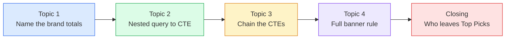
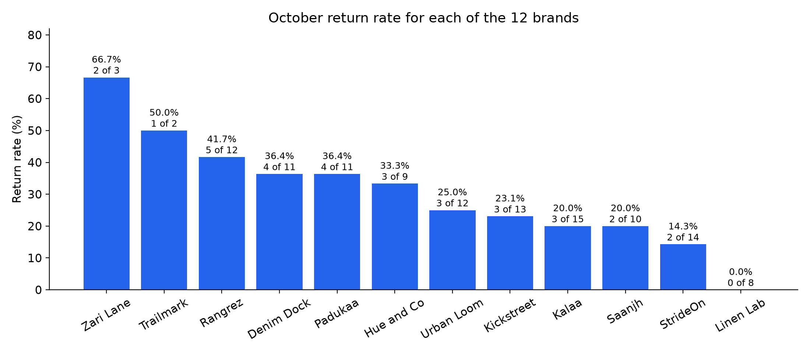
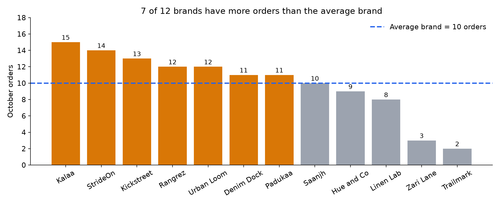
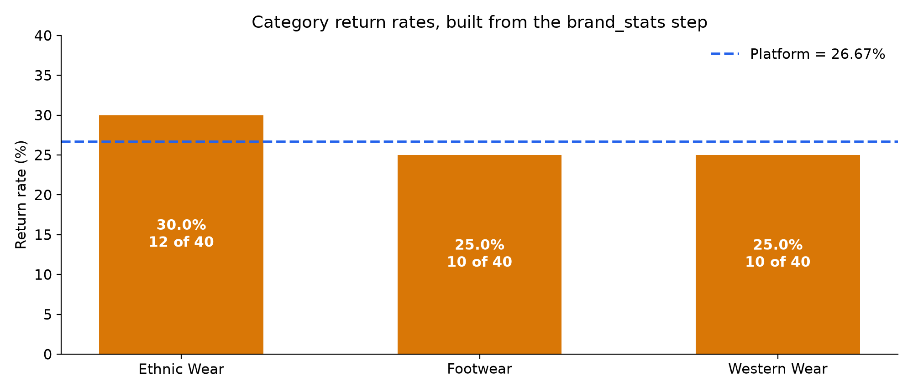
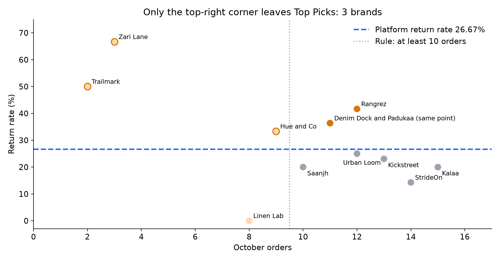
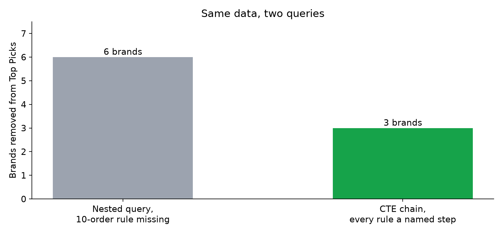

# <font color='#1d4ed8'>Lecture Script: Common Table Expressions (CTEs) (MySQL)</font>

---

## <font color='blue'>Agenda</font>

The lecture runs as four topics. Each topic ends with a quiz.

| Topic | What we do | Learning objectives covered | Minutes |
|:-:|:--|:--|:-:|
| 1 | Name the first result with `WITH` | Use a CTE to structure a complex query into readable steps | 25 |
| 2 | Turn the analyst's nested query into a CTE | Rewrite a nested subquery as a clearer CTE | 28 |
| 3 | Let one CTE read from another | Chain multiple CTEs in one query | 30 |
| 4 | Apply the full banner rule | Build a stepwise analytical query with CTEs | 25 |
| — | Closing: Outcome & Summary | | 12 |
| | **Total** | | **120** |

> <font color="red">**🎯 Instructor Note**</font> Pace: Topic 1 can move quickly, because learners already know `GROUP BY`. Spend the time on reading order in Topic 2 and on the order of CTEs in Topic 3.
> Let learners run every query. The outputs below come from MySQL 8.0.

---

## <font color='blue'>Scenario</font>

A Myntra-style fashion app shows a **Top Picks** banner on its home page. Every month, the category team reviews the brands on it.

| The October rule | Why it exists |
|:--|:--|
| A brand leaves Top Picks if its return rate is above the platform's return rate | Returns cost the app pickup, checking and refunds |
| ...but only if the brand has at least 10 orders in the month | Two returns out of three orders is too little evidence to judge a brand |

The analyst works from two tables: `brands` (12 brands in Ethnic Wear, Footwear and Western Wear) and `orders` (120 October orders, with `returned` = 1 for a returned order).

> <font color="red">**🎯 Instructor Note**</font> Myntra is only the setting. Do not claim it uses this data. The brands and `data/fashion_orders.sql` are invented for teaching.
> Learners load the file once in MySQL 8.0 or later and use `fashion_demo`. Treat 31 October 2026 as "today".

---

## <font color='blue'>Problem Statement</font>

The analyst wrote one long nested query for the October review. It had a subquery inside `FROM`, another inside `WHERE`, and brackets everywhere. The reviewer could not follow it and approved it anyway.

The query removed 6 brands from Top Picks. Three of them, Zari Lane, Trailmark and Hue and Co, had fewer than 10 orders. The 10-order rule was never in the query, and nobody could see that it was missing. Zari Lane's founder wrote in: "Two returns, and we lose the banner?"

> <font color='purple'>**Which brands should really leave Top Picks, and how do we write the query so that every rule is a step anyone can read and check?**</font>

> <font color="red">**🎯 Instructor Note**</font> Poll: "Zari Lane had 2 of its 3 October orders returned, a 66.7% return rate. Should it leave Top Picks?" Give learners 30 seconds to respond in chat. Reveal the answer in the Closing.

---

## <font color='blue'>What We Will Use</font>

One new clause, `WITH`, which gives a name to an in-between result. Each tool is explained when we first use it.

| Topic | Tools | In one line |
|:-:|:--|:--|
| 1 | `WITH name AS ( ... )`, `COUNT`, `SUM`, `ROUND` | name a result once, then read from it like a table |
| 2 | a subquery in `FROM`, the same query as a CTE | move the inner query to the top and give it a name |
| 3 | several CTEs separated by commas, `CROSS JOIN` | let each named result read from the one above it |
| 4 | a filter CTE, the full chain | put each business rule in its own named result |

---

## <font color='blue'>How: Walking Through the Top Picks Review</font>



---

## <font color='blue'>Topic 1: Name the First Result with WITH</font> `25 min`

> <font color='purple'>**Every part of the banner rule starts from the same thing: orders and returns for each brand. Can we work that out once and give it a name?**</font>

In Aggregations and GROUP BY you counted and summed rows per group. Last session, in Subqueries, you used one query's answer inside another. A CTE does the same job, but the inner query sits at the top with a name.

### <font color='green'>Example: orders and returns per brand</font>

> <font color='purple'>**How many October orders and returns does each brand have?**</font>

A **CTE (Common Table Expression)** is a named result that you write with `WITH name AS ( ... )` before the main query. The main query then reads from it like a table.

**Predict before running: What will happen?**

> <font color="red">**🎯 Instructor Note**</font> Expected: 12 rows, one per brand. Common guess: learners expect a new table to be saved in the database. Nothing is saved.

```sql
WITH brand_stats AS (
    SELECT brand_id, COUNT(*) AS order_count, SUM(returned) AS return_count
    FROM orders
    GROUP BY brand_id
)
SELECT brand_id, order_count, return_count
FROM brand_stats
ORDER BY brand_id;
```

**Output**

```
+----------+-------------+--------------+
| brand_id | order_count | return_count |
+----------+-------------+--------------+
|        1 |          15 |            3 |
|        2 |          12 |            5 |
|        3 |          10 |            2 |
|        4 |           3 |            2 |
|        5 |          14 |            2 |
|        6 |          11 |            4 |
|        7 |          13 |            3 |
|        8 |           2 |            1 |
|        9 |          12 |            3 |
|       10 |          11 |            4 |
|       11 |           9 |            3 |
|       12 |           8 |            0 |
+----------+-------------+--------------+
```

#### <font color='#c2410c'>Code Explanation</font>

- **Line 1** `WITH brand_stats AS (` starts the CTE and names it `brand_stats`.
- **Lines 2 to 4** An ordinary `GROUP BY` query. `SUM(returned)` counts the returns, because a returned order holds 1 and a kept order holds 0.
- **Line 5** The closing bracket ends the CTE. There is no semicolon here; the statement is not finished.
- **Lines 6 to 8** The main query reads `brand_stats` as if it were a table, sorted by id.

> <font color='green'>**Result**</font> The 12 brands have 120 orders and 32 returns between them. The in-between result now has a name, `brand_stats`, that tells a reader what it holds.

### <font color='green'>Extending it: add names and a return rate</font>

> <font color='purple'>**Which brands have the highest return rate?**</font>

> <font color="red">**🎯 Instructor Note**</font> Ask: "Which brand will top the list?" Give learners 30 seconds to respond in chat. Expected: Zari Lane, with only 3 orders.

```sql
WITH brand_stats AS (
    SELECT brand_id, COUNT(*) AS order_count, SUM(returned) AS return_count
    FROM orders
    GROUP BY brand_id
)
SELECT b.brand_name, s.order_count, s.return_count,
       ROUND(100 * s.return_count / s.order_count, 1) AS return_pct
FROM brand_stats s
JOIN brands b ON b.brand_id = s.brand_id
ORDER BY return_pct DESC, b.brand_name;
```

**Output**

```
+------------+-------------+--------------+------------+
| brand_name | order_count | return_count | return_pct |
+------------+-------------+--------------+------------+
| Zari Lane  |           3 |            2 |       66.7 |
| Trailmark  |           2 |            1 |       50.0 |
| Rangrez    |          12 |            5 |       41.7 |
| Denim Dock |          11 |            4 |       36.4 |
| Padukaa    |          11 |            4 |       36.4 |
| Hue and Co |           9 |            3 |       33.3 |
| Urban Loom |          12 |            3 |       25.0 |
| Kickstreet |          13 |            3 |       23.1 |
| Kalaa      |          15 |            3 |       20.0 |
| Saanjh     |          10 |            2 |       20.0 |
| StrideOn   |          14 |            2 |       14.3 |
| Linen Lab  |           8 |            0 |        0.0 |
+------------+-------------+--------------+------------+
```

#### <font color='#c2410c'>Code Explanation</font>

- **Lines 1 to 5** The same `brand_stats` CTE as before.
- **Lines 6 and 7** The return rate is returns divided by orders, times 100. `ROUND(..., 1)` keeps one decimal place.
- **Lines 8 and 9** A CTE can be given an alias (`s`) and joined like any table. Here it is joined to `brands` for the names.
- **Line 10** Highest rate first. The brand name breaks the tie between Denim Dock and Padukaa.

> <font color='green'>**Result**</font> The two highest rates belong to the two smallest brands, Zari Lane (3 orders) and Trailmark (2 orders). A single return moves a small brand's rate a long way.

<p align="center"></p>

### <font color='green'>Extending it: where does a CTE live?</font>

> <font color='purple'>**After running the query above, can we read `brand_stats` in a new query?**</font>

> <font color="red">**🎯 Instructor Note**</font> Ask for a prediction first. Expected: an error, because the CTE ended with the statement.

```sql
SELECT * FROM brand_stats;
```

**Output**

```
ERROR 1146 (42S02) at line 1: Table 'fashion_demo.brand_stats' doesn't exist
```

#### <font color='#c2410c'>Logic Explanation</font>

- A CTE exists only inside the one statement that defines it. At the semicolon it is gone.
- Nothing was saved in `fashion_demo`, so there is nothing to clean up afterwards.

> <font color='green'>**Result**</font> Every query that needs `brand_stats` must start with its own `WITH` block.

### <font color='purple'>Quiz 1</font>

**Question:** A learner writes `WITH brand_stats AS ( ... ) SELECT * FROM brand_stats;` and it runs. Which statement about `brand_stats` is true?

**Options:**
- A) It is now a saved table that other learners can query
- B) It holds one row per order, because `orders` has 120 rows
- C) It exists only while that one statement runs, and holds one row per brand
- D) It must be dropped with `DROP TABLE` before it is used again

**Correct Answer:** C

**Explanation:**
- **A)** Wrong: a CTE is never saved; a new query gets error 1146.
- **B)** Wrong: the `GROUP BY brand_id` inside the CTE makes one row per brand, 12 in all.
- **C)** Correct: the CTE lives for one statement and holds the grouped result.
- **D)** Wrong: nothing was created, so there is nothing to drop.

---

## <font color='blue'>Topic 2: Turn the Analyst's Nested Query into a CTE</font> `28 min`

> <font color='purple'>**Topic 1 gave us a return rate for every brand. Now look at how the analyst compared those rates with the platform. Why could nobody check it?**</font>

In Subqueries you put a query inside `WHERE` with brackets. The analyst also put one inside `FROM`.

### <font color='green'>Example: the analyst's nested query, then the CTE</font>

> <font color='purple'>**Which brands have a return rate above the platform's return rate?**</font>

**Predict before running: What will happen?**

> <font color="red">**🎯 Instructor Note**</font> Expected: 6 brands, every brand above 26.67%. Ask learners to point at where the 10-order rule should go. It is not in the query.

```sql
SELECT b.brand_name, ROUND(100 * s.return_count / s.order_count, 1) AS return_pct
FROM (SELECT brand_id, COUNT(*) AS order_count, SUM(returned) AS return_count
      FROM orders GROUP BY brand_id) AS s
JOIN brands b ON b.brand_id = s.brand_id
WHERE s.return_count / s.order_count >
      (SELECT SUM(returned) / COUNT(*) FROM orders)
ORDER BY return_pct DESC, b.brand_name;
```

**Output**

```
+------------+------------+
| brand_name | return_pct |
+------------+------------+
| Zari Lane  |       66.7 |
| Trailmark  |       50.0 |
| Rangrez    |       41.7 |
| Denim Dock |       36.4 |
| Padukaa    |       36.4 |
| Hue and Co |       33.3 |
+------------+------------+
```

#### <font color='#c2410c'>Code Explanation</font>

- **Line 1** Shows the brand name and its return rate, but the reader does not yet know where `s` comes from.
- **Lines 2 and 3** A subquery in `FROM` works as a temporary table and must have an alias, here `s`. It is the same grouping as `brand_stats`.
- **Line 4** Joins the names.
- **Lines 5 and 6** Keeps a brand whose rate beats the platform rate, worked out by a second subquery.

Now the same query as a CTE. The inner query moves to the top and gets a name.

```sql
WITH brand_stats AS (
    SELECT brand_id, COUNT(*) AS order_count, SUM(returned) AS return_count
    FROM orders GROUP BY brand_id
)
SELECT b.brand_name, ROUND(100 * s.return_count / s.order_count, 1) AS return_pct
FROM brand_stats s
JOIN brands b ON b.brand_id = s.brand_id
WHERE s.return_count / s.order_count > (SELECT SUM(returned) / COUNT(*) FROM orders)
ORDER BY return_pct DESC, b.brand_name;
```

**Output**

```
+------------+------------+
| brand_name | return_pct |
+------------+------------+
| Zari Lane  |       66.7 |
| Trailmark  |       50.0 |
| Rangrez    |       41.7 |
| Denim Dock |       36.4 |
| Padukaa    |       36.4 |
| Hue and Co |       33.3 |
+------------+------------+
```

#### <font color='#c2410c'>Code Explanation</font>

- **Lines 1 to 4** The bracketed query from `FROM` is cut out, placed at the top and named `brand_stats`.
- **Line 6** Where the brackets used to be, the main query now says `FROM brand_stats s`.
- **Lines 5, 7 to 9** Everything else is unchanged.

> <font color='green'>**Result**</font> Both queries return the same 6 brands. The CTE version reads top to bottom: first the brand totals, then the comparison. It is easier to read, but it is still wrong, because the 10-order rule is missing.

### <font color='green'>Extending it: a nested query two levels deep</font>

> <font color='purple'>**Which brands have more orders than the average brand?**</font>

> <font color="red">**🎯 Instructor Note**</font> Ask learners to find the innermost query before running it. Expected: 7 brands, since the average brand has 120 / 12 = 10 orders.

```sql
SELECT b.brand_name, COUNT(*) AS order_count
FROM orders o
JOIN brands b ON b.brand_id = o.brand_id
GROUP BY b.brand_id, b.brand_name
HAVING COUNT(*) > (SELECT AVG(n)
                   FROM (SELECT COUNT(*) AS n FROM orders GROUP BY brand_id) AS t)
ORDER BY order_count DESC, b.brand_name;
```

**Output**

```
+------------+-------------+
| brand_name | order_count |
+------------+-------------+
| Kalaa      |          15 |
| StrideOn   |          14 |
| Kickstreet |          13 |
| Rangrez    |          12 |
| Urban Loom |          12 |
| Denim Dock |          11 |
| Padukaa    |          11 |
+------------+-------------+
```

The same question as a CTE, where the brand counts are written once and read twice:

```sql
WITH brand_counts AS (
    SELECT brand_id, COUNT(*) AS order_count
    FROM orders GROUP BY brand_id
)
SELECT b.brand_name, c.order_count
FROM brand_counts c
JOIN brands b ON b.brand_id = c.brand_id
WHERE c.order_count > (SELECT AVG(order_count) FROM brand_counts)
ORDER BY c.order_count DESC, b.brand_name;
```

**Output**

```
+------------+-------------+
| brand_name | order_count |
+------------+-------------+
| Kalaa      |          15 |
| StrideOn   |          14 |
| Kickstreet |          13 |
| Rangrez    |          12 |
| Urban Loom |          12 |
| Denim Dock |          11 |
| Padukaa    |          11 |
+------------+-------------+
```

#### <font color='#c2410c'>Code Explanation</font>

- **Nested version, lines 5 and 6** Three levels: the outer query, a subquery for the average, and inside that a subquery for the counts. It counts orders per brand twice, once in the outer query and once in `t`.
- **CTE version, lines 1 to 4** The counts are worked out once and named `brand_counts`.
- **CTE version, lines 6 and 8** The main query reads `brand_counts` twice: once for the rows and once, in the subquery, for the average.

> <font color='green'>**Result**</font> Same 7 brands. Saanjh, with exactly 10 orders, is not above the average of 10, so it is left out of both.

<p align="center"></p>

> <font color='#b45309'>**Common mistake**</font> Rewriting only the outer level and leaving the innermost subquery in place. Find the deepest brackets first; that is usually the first CTE.

### <font color='purple'>Quiz 2</font>

**Question:** You rewrite the analyst's nested query from the Example as a CTE, without changing any condition. What happens to the result?

**Options:**
- A) Nothing: the same 6 brands come back, only the reading order of the query changes
- B) Three brands drop out, because a CTE applies the 10-order rule on its own
- C) The result gains rows, because a CTE keeps brands with no returns
- D) MySQL rejects it, because a CTE cannot be joined to another table

**Correct Answer:** A

**Explanation:**
- **A)** Correct: a rewrite changes how the query reads, not what it calculates.
- **B)** Wrong: a CTE applies only the conditions you write; the 10-order rule is still missing.
- **C)** Wrong: the `WHERE` condition is unchanged, so the same rows pass.
- **D)** Wrong: we joined `brand_stats s` to `brands` in Topic 1 without any problem.

---

## <font color='blue'>Topic 3: Let One CTE Read from Another</font> `30 min`

> <font color='purple'>**The CTE version still hides one calculation inside brackets: the platform rate. Can that become a named result too?**</font>

In Joins II you saw that a `CROSS JOIN` pairs every row with every row. With a table of one row, that safely adds the same value to every row.

### <font color='green'>Example: the platform rate as its own CTE</font>

> <font color='purple'>**What is the platform's return rate, worked out from `brand_stats`?**</font>

**Predict before running: What will happen?**

> <font color="red">**🎯 Instructor Note**</font> Expected: 32 returns out of 120 orders, 26.67%. Common guess: learners average the 12 brand rates instead.

```sql
WITH brand_stats AS (
    SELECT brand_id, COUNT(*) AS order_count, SUM(returned) AS return_count
    FROM orders GROUP BY brand_id
),
platform AS (
    SELECT SUM(return_count) / SUM(order_count) AS rate
    FROM brand_stats
)
SELECT ROUND(100 * rate, 2) AS platform_pct FROM platform;
```

**Output**

```
+--------------+
| platform_pct |
+--------------+
|        26.67 |
+--------------+
```

#### <font color='#c2410c'>Code Explanation</font>

- **Lines 1 to 4** `brand_stats`, as before. The comma after the bracket means "another CTE follows".
- **Lines 5 to 8** `platform` reads from `brand_stats`, not from `orders`. This is a **chain**: one CTE uses the result of the one above it.
- **Line 9** The main query reads only the last CTE.

> <font color='green'>**Result**</font> The platform rate is 32 / 120 = 26.67%. It is a total of returns over a total of orders, not an average of the 12 brand rates.

Now use both CTEs to flag the brands, with the platform rate shown beside each one:

```sql
WITH brand_stats AS (SELECT brand_id, COUNT(*) AS order_count, SUM(returned) AS return_count
                     FROM orders GROUP BY brand_id),
     platform AS (SELECT SUM(return_count) / SUM(order_count) AS rate FROM brand_stats)
SELECT b.brand_name, ROUND(100 * s.return_count / s.order_count, 1) AS return_pct,
       ROUND(100 * p.rate, 1) AS platform_pct
FROM brand_stats s
JOIN brands b ON b.brand_id = s.brand_id
CROSS JOIN platform p
WHERE s.return_count / s.order_count > p.rate
ORDER BY return_pct DESC, b.brand_name;
```

**Output**

```
+------------+------------+--------------+
| brand_name | return_pct | platform_pct |
+------------+------------+--------------+
| Zari Lane  |       66.7 |         26.7 |
| Trailmark  |       50.0 |         26.7 |
| Rangrez    |       41.7 |         26.7 |
| Denim Dock |       36.4 |         26.7 |
| Padukaa    |       36.4 |         26.7 |
| Hue and Co |       33.3 |         26.7 |
+------------+------------+--------------+
```

#### <font color='#c2410c'>Code Explanation</font>

- **Lines 1 to 3** Two CTEs, separated by a comma. `WITH` is written only once.
- **Line 8** `platform` has one row, so the `CROSS JOIN` adds the rate to every brand row.
- **Line 9** The comparison now reads `> p.rate` instead of a bracketed subquery.

> <font color='green'>**Result**</font> The same 6 brands as Topic 2, but no brackets are left in the main query. Each in-between number has a name.

### <font color='green'>Extending it: a third CTE for categories</font>

> <font color='purple'>**What is the return rate of each category?**</font>

> <font color="red">**🎯 Instructor Note**</font> Ask which category has the most returns. Expected: Ethnic Wear, 12 of 40.

```sql
WITH brand_stats AS (SELECT brand_id, COUNT(*) AS order_count, SUM(returned) AS return_count
                     FROM orders GROUP BY brand_id),
     category_stats AS (SELECT b.category, SUM(s.order_count) AS order_count,
                               SUM(s.return_count) AS return_count
                        FROM brand_stats s JOIN brands b ON b.brand_id = s.brand_id
                        GROUP BY b.category)
SELECT category, order_count, return_count,
       ROUND(100 * return_count / order_count, 1) AS return_pct
FROM category_stats
ORDER BY category;
```

**Output**

```
+--------------+-------------+--------------+------------+
| category     | order_count | return_count | return_pct |
+--------------+-------------+--------------+------------+
| Ethnic Wear  |          40 |           12 |       30.0 |
| Footwear     |          40 |           10 |       25.0 |
| Western Wear |          40 |           10 |       25.0 |
+--------------+-------------+--------------+------------+
```

#### <font color='#c2410c'>Code Explanation</font>

- **Lines 3 to 6** `category_stats` reads `brand_stats`, joins the category from `brands`, and adds the brand totals up per category.
- **Lines 7 to 10** The main query turns the category totals into rates.

> <font color='green'>**Result**</font> Ethnic Wear returns 30.0% of orders; Footwear and Western Wear return 25.0% each. The chain went from orders to brands to categories, one named result at a time.

<p align="center"></p>

### <font color='green'>Extending it: the order of the CTEs matters</font>

> <font color='purple'>**What if `platform` is written above `brand_stats`?**</font>

> <font color="red">**🎯 Instructor Note**</font> Ask for a prediction. Many learners expect MySQL to sort the CTEs out on its own.

```sql
WITH platform AS (SELECT SUM(return_count) / SUM(order_count) AS rate FROM brand_stats),
     brand_stats AS (SELECT brand_id, COUNT(*) AS order_count, SUM(returned) AS return_count
                     FROM orders GROUP BY brand_id)
SELECT ROUND(100 * rate, 2) AS platform_pct FROM platform;
```

**Output**

```
ERROR 1146 (42S02) at line 1: Table 'fashion_demo.brand_stats' doesn't exist
```

#### <font color='#c2410c'>Logic Explanation</font>

- MySQL reads the CTEs from top to bottom. When it reaches `platform`, `brand_stats` has not been defined yet.
- A CTE can read from any CTE above it, never from one below it.

> <font color='green'>**Result**</font> Write the chain in the order the work happens: totals first, then anything built from them.

### <font color='purple'>Quiz 3</font>

**Question:** A query starts `WITH a AS (... FROM orders), b AS (... FROM a), c AS (... FROM b)`. Which statement is true?

**Options:**
- A) Each CTE needs its own `WITH` keyword
- B) `c` cannot read from `b`, because a CTE may only read real tables
- C) The main query can read only `c`, the last CTE
- D) `b` reads `a`'s result and `c` reads `b`'s, so the order of the three matters

**Correct Answer:** D

**Explanation:**
- **A)** Wrong: `WITH` is written once and the CTEs are separated by commas.
- **B)** Wrong: reading an earlier CTE is exactly what a chain does, as `platform` read `brand_stats`.
- **C)** Wrong: the main query can read any of them; Topic 3's flag query read both `brand_stats` and `platform`.
- **D)** Correct: each CTE uses the one above it, and moving one above its source gives error 1146.

---

## <font color='blue'>Topic 4: Apply the Full Banner Rule</font> `25 min`

> <font color='purple'>**The chain now finds the 6 brands above the platform rate. Where does the 10-order rule go, so that a reviewer can see it?**</font>

In Refining Groups with HAVING you filtered groups with `HAVING COUNT(*) >= ...`. Once the counts sit in a CTE, a plain `WHERE` on `order_count` does the same job.

### <font color='green'>Example: one named result per rule</font>

> <font color='purple'>**Which brands with at least 10 orders have a return rate above the platform's?**</font>

**Predict before running: What will happen?**

> <font color="red">**🎯 Instructor Note**</font> Expected: 3 brands. Zari Lane, Trailmark and Hue and Co drop out because they have fewer than 10 orders.

```sql
WITH brand_stats AS (SELECT brand_id, COUNT(*) AS order_count, SUM(returned) AS return_count
                     FROM orders GROUP BY brand_id),
     platform AS (SELECT SUM(return_count) / SUM(order_count) AS rate FROM brand_stats),
     eligible AS (SELECT * FROM brand_stats WHERE order_count >= 10)
SELECT b.brand_name, e.order_count, ROUND(100 * e.return_count / e.order_count, 1) AS return_pct
FROM eligible e
JOIN brands b ON b.brand_id = e.brand_id
CROSS JOIN platform p
WHERE e.return_count / e.order_count > p.rate
ORDER BY return_pct DESC, b.brand_name;
```

**Output**

```
+------------+-------------+------------+
| brand_name | order_count | return_pct |
+------------+-------------+------------+
| Rangrez    |          12 |       41.7 |
| Denim Dock |          11 |       36.4 |
| Padukaa    |          11 |       36.4 |
+------------+-------------+------------+
```

#### <font color='#c2410c'>Code Explanation</font>

- **Lines 1 and 2** `brand_stats`: orders and returns per brand.
- **Line 3** `platform`: the bar to beat, from all 120 orders.
- **Line 4** `eligible`: the 10-order rule, written as its own named result.
- **Lines 5 to 10** The main query compares each eligible brand with the platform rate.

> <font color='green'>**Result**</font> Only Rangrez, Denim Dock and Padukaa break both parts of the rule. Each rule is now one line with a name, so a reviewer can tick them off.

<p align="center"></p>

### <font color='green'>Extending it: check one named result on its own</font>

> <font color='purple'>**How do we check the `eligible` result before trusting the final answer?**</font>

> <font color="red">**🎯 Instructor Note**</font> Show this as a habit: point the main query at one CTE and look at it. Expected: 8 brands.

```sql
WITH brand_stats AS (SELECT brand_id, COUNT(*) AS order_count, SUM(returned) AS return_count
                     FROM orders GROUP BY brand_id),
     eligible AS (SELECT * FROM brand_stats WHERE order_count >= 10)
SELECT COUNT(*) AS brands, SUM(order_count) AS orders_kept, SUM(return_count) AS returns_kept
FROM eligible;
```

**Output**

```
+--------+-------------+--------------+
| brands | orders_kept | returns_kept |
+--------+-------------+--------------+
|      8 |          98 |           26 |
+--------+-------------+--------------+
```

#### <font color='#c2410c'>Logic Explanation</font>

- Only the last `SELECT` changes. The CTEs above it stay exactly as they are.
- 8 brands pass the 10-order rule. Saanjh, with exactly 10 orders, is in, because the rule says "at least 10".
- The 4 brands left out (Zari Lane, Trailmark, Hue and Co, Linen Lab) hold 22 orders and 6 returns.

> <font color='green'>**Result**</font> Building the query in named results lets you test each rule alone. A nested query has no such place to look.

### <font color='green'>Extending it: which orders set the bar?</font>

> <font color='purple'>**Should the platform rate come from all brands or only from the eligible ones?**</font>

> <font color="red">**🎯 Instructor Note**</font> Ask learners to guess whether the bar goes up or down. Expected: slightly down, to 26.53%.

```sql
WITH brand_stats AS (SELECT brand_id, COUNT(*) AS order_count, SUM(returned) AS return_count
                     FROM orders GROUP BY brand_id),
     eligible AS (SELECT * FROM brand_stats WHERE order_count >= 10),
     platform AS (SELECT SUM(return_count) / SUM(order_count) AS rate FROM eligible)
SELECT ROUND(100 * rate, 2) AS platform_pct FROM platform;
```

**Output**

```
+--------------+
| platform_pct |
+--------------+
|        26.53 |
+--------------+
```

#### <font color='#c2410c'>Logic Explanation</font>

- Reading from `eligible` gives 26 / 98 = 26.53%. Reading from `brand_stats` gave 32 / 120 = 26.67%.
- The rule says "the platform's return rate", which means all orders. So `platform` reads `brand_stats`, as in the Example.
- Here the list stays the same 3 brands: Urban Loom, the next highest eligible brand at 25.0%, is below both bars.

> <font color='green'>**Result**</font> Which CTE a step reads from is a business decision. Name it and agree on it before running the query.

### <font color='purple'>Quiz 4</font>

**Question:** The category team lowers the rule from "at least 10 orders" to "at least 9 orders". `platform` still reads from `brand_stats`. How many brands now leave Top Picks?

**Options:**
- A) 3
- B) 4
- C) 6
- D) 5

**Correct Answer:** B

**Explanation:**
- **A)** Wrong: that is the answer for the 10-order rule; one more brand now qualifies.
- **B)** Correct: Hue and Co (9 orders, 33.3%) joins Rangrez, Denim Dock and Padukaa.
- **C)** Wrong: Zari Lane (3 orders) and Trailmark (2 orders) still fail the 9-order rule.
- **D)** Wrong: only Hue and Co has exactly 9 orders, so only one brand is added.

---

## <font color='blue'>Closing: Outcome & Summary</font> `12 min`

Back to the problem: remove a brand from Top Picks only if it has at least 10 orders and a return rate above the platform's. We use each topic once.

> <font color='purple'>**1. What did every part of the rule start from?**</font>

Orders and returns per brand, named once as `brand_stats` (Topic 1).

> <font color='purple'>**2. Why did nobody catch the missing rule?**</font>

The analyst's query hid its in-between results inside brackets. Rewritten as a CTE, it reads top to bottom (Topic 2).

> <font color='purple'>**3. Where did the platform rate come from?**</font>

From a second CTE, `platform`, chained to `brand_stats`: 32 / 120 = 26.67% (Topic 3).

> <font color='purple'>**4. How many brands should leave, compared with the analyst's list?**</font>

```sql
WITH brand_stats AS (SELECT brand_id, COUNT(*) AS order_count, SUM(returned) AS return_count
                     FROM orders GROUP BY brand_id),
     platform AS (SELECT SUM(return_count) / SUM(order_count) AS rate FROM brand_stats)
SELECT SUM(s.return_count / s.order_count > p.rate) AS flagged_without_rule,
       SUM(s.return_count / s.order_count > p.rate AND s.order_count >= 10) AS flagged_with_rule
FROM brand_stats s
CROSS JOIN platform p;
```

**Output**

```
+----------------------+-------------------+
| flagged_without_rule | flagged_with_rule |
+----------------------+-------------------+
|                    6 |                 3 |
+----------------------+-------------------+
```

#### <font color='#c2410c'>Code Explanation</font>

- **Lines 1 to 3** The chain of two CTEs from Topic 3.
- **Line 4** In MySQL a true comparison counts as 1 and a false one as 0, so `SUM` counts the brands above the platform rate: the analyst's reading.
- **Line 5** Adds the 10-order rule from Topic 4's `eligible` step.

<p align="center"></p>

### <font color='green'>Outcome</font>

| | Analyst's nested query | CTE chain with every rule named |
|:--|:-:|:-:|
| Platform return rate used | 26.67% | 26.67% |
| 10-order rule applied? | No | Yes, in `eligible` |
| Brands removed from Top Picks | 6 | 3 |
| Zari Lane, Trailmark, Hue and Co removed? | Yes | No |

> <font color='green'>**Therefore,**</font> only Rangrez, Denim Dock and Padukaa leave Top Picks for October. The nested query removed three more brands that had too few orders to judge. Writing each rule as a named CTE made the missing rule visible and checkable.

> <font color="red">**🎯 Instructor Note**</font> Reveal the poll: Zari Lane's 66.7% is above the platform's 26.67%, but it had only 3 orders, so the rule keeps it on Top Picks.

### <font color='green'>Summary</font>

| Learning objective | Takeaway |
|:--|:--|
| Structure a query into readable steps | `WITH name AS ( ... )` names an in-between result; the main query reads it like a table, and it lasts for one statement |
| Rewrite a nested subquery as a CTE | Cut the deepest bracketed query out, put it at the top with a name, and read from the name; the result does not change |
| Chain multiple CTEs | One `WITH`, CTEs separated by commas; each can read the ones above it, never the ones below |
| Build a stepwise analytical query | Give each business rule its own CTE, and check any CTE alone by pointing the final `SELECT` at it |
| **Practical value** | A reviewer can read and test every rule, so a missing condition is caught before it costs a brand its banner |

---

# <font color='red'>Launch the Feedback Poll</font>

> <font color="red">**🎯 Instructor Note**</font> Reminder: launch the feedback poll now to collect learner feedback.
