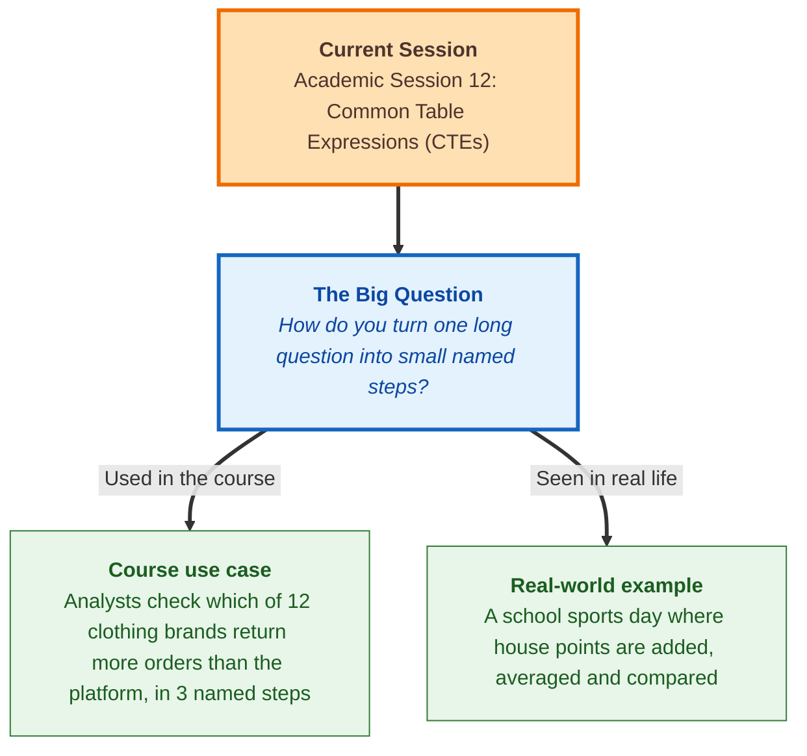

## <span style="color:#2F7DDE">Academic Session 12: Common Table Expressions (CTEs)</span>

### <span style="color:#2F7DDE">Mental Map</span>



---

### <span style="color:#2F7DDE">What You'll Learn</span>

Have you ever wondered how the scorer on sports day knows which houses beat the average?

By the end of this session, you will be able to:

- <span style="color:#D9660B">**Identify**</span> the three small steps hidden inside "Which houses scored above the average?".
- <span style="color:#D9660B">**Explain**</span> why giving each step a name makes a long question easier to read.
- <span style="color:#D9660B">**Use**</span> the answer of one named step, such as house totals, inside the next step.
- <span style="color:#D9660B">**Compare**</span> a question tucked inside another question with the same question written as named steps.
- <span style="color:#D9660B">**Build**</span> a chain of three named steps that finds the houses above the average.

> <span style="color:#2F7DDE">**Topics you will meet:**</span> CTEs with WITH, nested subqueries as CTEs, chained CTEs and stepwise queries.
>
> Join the session to learn each of these in detail.

---

### <span style="color:#2F7DDE">Why You Are Learning This Topic</span>

Your school holds a sports day for three houses. Each student wins points in their events. At the end, the principal asks which houses scored above the average house. The scorer cannot answer in one go. The scorer adds each house's points, finds the average, then compares.

A <span style="color:#D9660B">**CTE**</span> means a named step whose answer the rest of your query can use.

In your course, you will write named steps like these to check brands on a shopping app.

> <span style="color:#2F7DDE">**Think about it:**</span> What would you write down first on the scorer's sheet?

---

### <span style="color:#2F7DDE">The Sports Day Puzzle</span>

Here are the points six students won for their houses.

| Student | House | Points |
|:-------:|:-----:|:------:|
| Aditi | Red | 10 |
| Kunal | Red | 8 |
| Riya | Green | 8 |
| Sameer | Green | 4 |
| Tanvi | Yellow | 9 |
| Yash | Yellow | 9 |

<span style="color:#D9660B">**What you want to happen:**</span>

- Add up the points for each house.
- Find the average of the three house totals.
- List the houses whose total beats that average.

Here is how it might start. You do not need to understand it yet.

```sql
WITH house_totals AS (SELECT house, SUM(points) AS total FROM sports_day GROUP BY house)
SELECT house, total FROM house_totals
WHERE total > (SELECT AVG(total) FROM house_totals);
```

> <span style="color:#D9660B">**Wonder about this:**</span>
>
> - Why does the second line read from house_totals instead of the student list?
> - Could the average step also get its own name?

---

### <span style="color:#2F7DDE">Think It Through</span>

There is no wrong first try. Keep your guesses for the session.

**1. What is the points total for each of the three houses?**
Hint: Add the two students in each house.

**2. What is the average of those three totals?**
Hint: Add the three totals, then divide by 3.

**3. Which houses scored above that average?**
Hint: Compare each house total with your answer to question 2.

---

### <span style="color:#2F7DDE">One Question to Carry Into the Session</span>

> <span style="color:#2F7DDE">**How can you give a step a name and use its answer later in the same query?**</span>
>
> And what changes when one named step reads from another?
