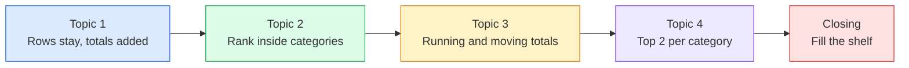
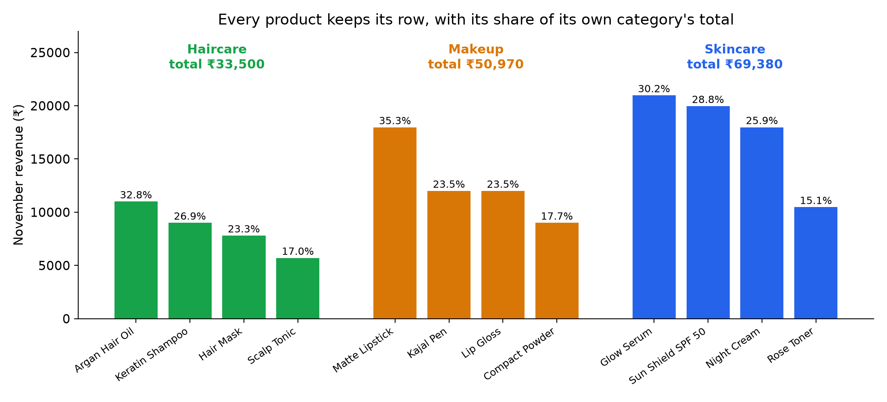
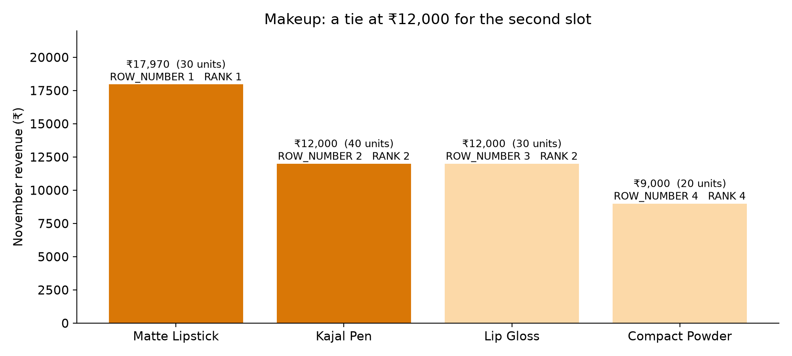
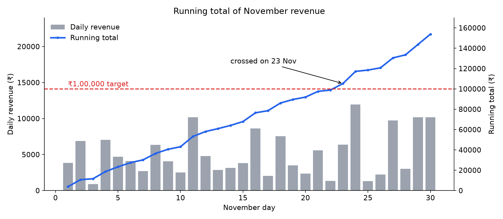
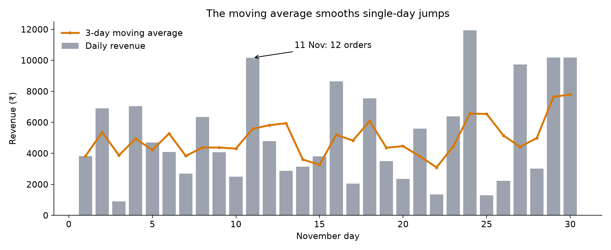
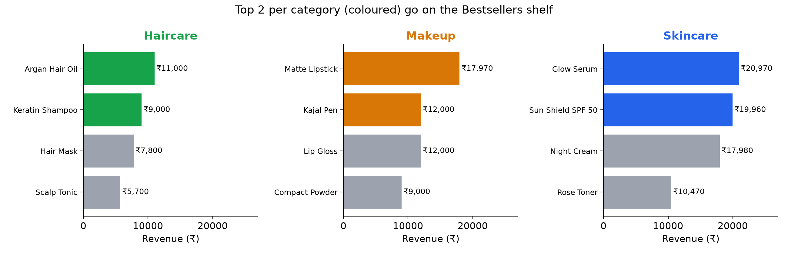
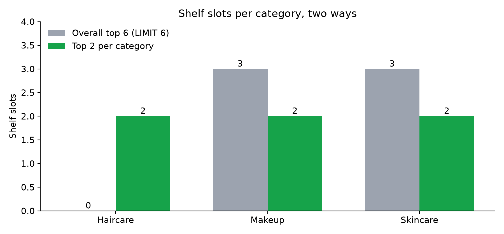

# <font color='#1d4ed8'>Lecture Script: Window Functions (MySQL)</font>

---

## <font color='blue'>Agenda</font>

The lecture runs as four topics. Each topic ends with a quiz.

| Topic | What we do | Learning objectives covered | Minutes |
|:-:|:--|:--|:-:|
| 1 | Keep every row and still see the group total | Explain what a window function does versus a GROUP BY, by intuition | 25 |
| 2 | Number and rank products inside each category | Use ranking functions such as ROW_NUMBER and RANK with PARTITION BY | 30 |
| 3 | Build running totals and moving averages by day | Compute running totals and moving aggregates over a window | 35 |
| 4 | Fill the shelf with the top 2 per category | Answer a ranking question such as top products per category | 18 |
| — | Closing: Outcome & Summary | | 12 |
| | **Total** | | **120** |

> <font color="red">**🎯 Instructor Note**</font> Pace: in Topic 1, spend the time on the "rows stay" picture, not on syntax. Topic 3 is the longest, because the frame and the filter trap need slow reading.
> Let learners run every query. The outputs below come from MySQL 8.0.

---

## <font color='blue'>Scenario</font>

It is 30 November at a Nykaa-style beauty app. The home page has a **Bestsellers** shelf with six slots, two for each category: Skincare, Makeup and Haircare.

Before Monday's review, the merchandising lead wants three answers from the `orders` table (120 November orders across 12 products):

1. The top two products in each category by November revenue. If two products tie on revenue, the one with more units sold wins.
2. The day November revenue crossed the ₹1,00,000 target.
3. A smoothed view of daily revenue, so that one busy day is not mistaken for a trend.

> <font color="red">**🎯 Instructor Note**</font> Nykaa is only the setting. Do not claim it uses this data. The products and `data/beauty_orders.sql` are invented for teaching.
> Learners load the file once in MySQL 8.0 or later and use `beauty_demo`. Treat 30 November 2026 as "today".

---

## <font color='blue'>Problem Statement</font>

The analyst's first draft filled the six slots with `ORDER BY revenue DESC LIMIT 6`. That picks the six biggest products in the whole store, not two per category.

The draft put 3 Skincare and 3 Makeup products on the shelf, and no Haircare product at all. Argan Hair Oil, Haircare's best seller at ₹11,000, was missing. A shopper opening the Haircare section saw no bestsellers, and the Haircare team asked why their category had been dropped.

> <font color='purple'>**Which two products from each category belong on the Bestsellers shelf, and how do we rank inside each category without losing any rows?**</font>

> <font color="red">**🎯 Instructor Note**</font> Poll: "Kajal Pen and Lip Gloss both made ₹12,000 in Makeup. Which one gets the second Makeup slot?" Give learners 30 seconds to respond in chat. Reveal the answer in the Closing.

---

## <font color='blue'>What We Will Use</font>

One new idea, a function with `OVER ( ... )` that looks at a group of rows but keeps every row. Each tool is explained when we first use it.

| Topic | Tools | In one line |
|:-:|:--|:--|
| 1 | `SUM(...) OVER (PARTITION BY ...)` | put a group total beside every row instead of collapsing the rows |
| 2 | `ROW_NUMBER()`, `RANK()`, `OVER (PARTITION BY ... ORDER BY ...)` | number or rank the rows inside each group |
| 3 | `SUM(...) OVER (ORDER BY ...)`, `AVG(...) OVER (... ROWS BETWEEN 2 PRECEDING AND CURRENT ROW)` | running totals and moving averages |
| 4 | a CTE around the ranking, then `WHERE` on the rank | keep the top N rows of each group |

---

## <font color='blue'>How: Walking Through the Bestsellers Shelf</font>



---

## <font color='blue'>Topic 1: Keep Every Row and Still See the Group Total</font> `25 min`

> <font color='purple'>**To pick the best products in a category, we must see each product and its category together. What does GROUP BY give us?**</font>

In Aggregations and GROUP BY you summed revenue per category. That answer has one row per category, and the individual rows are gone.

### <font color='green'>Example: GROUP BY collapses, a window keeps</font>

> <font color='purple'>**What is each category's November revenue?**</font>

**Predict before running: What will happen?**

> <font color="red">**🎯 Instructor Note**</font> Expected: 3 rows, one per category. Ask learners where the 120 orders went.

```sql
SELECT category, SUM(amount) AS revenue
FROM orders
GROUP BY category
ORDER BY revenue DESC;
```

**Output**

```
+----------+---------+
| category | revenue |
+----------+---------+
| Skincare |   69380 |
| Makeup   |   50970 |
| Haircare |   33500 |
+----------+---------+
```

Now the same sum, written as a **window function**: a calculation over a group of rows (the window) that keeps every row and adds the answer beside it.

**Predict before running: What will happen?**

> <font color="red">**🎯 Instructor Note**</font> Expected: one row per order, each with its category's total. Common guess: 3 rows again.

```sql
SELECT order_id, category, amount,
       SUM(amount) OVER (PARTITION BY category) AS category_revenue
FROM orders
ORDER BY order_id
LIMIT 6;
```

**Output**

```
+----------+----------+--------+------------------+
| order_id | category | amount | category_revenue |
+----------+----------+--------+------------------+
|     8001 | Makeup   |    599 |            50970 |
|     8002 | Haircare |   1350 |            33500 |
|     8003 | Makeup   |   1500 |            50970 |
|     8004 | Haircare |    380 |            33500 |
|     8005 | Makeup   |   3300 |            50970 |
|     8006 | Haircare |   1800 |            33500 |
+----------+----------+--------+------------------+
```

#### <font color='#c2410c'>Code Explanation</font>

- **Line 1** Shows each order's own columns.
- **Line 2** `OVER (...)` turns `SUM` into a window function. `PARTITION BY category` makes one window per category, like the groups of `GROUP BY`, but the rows are not merged.
- **Lines 3 to 5** All 120 rows come back; `LIMIT 6` shows the first six by order id.

> <font color='green'>**Result**</font> `GROUP BY` answers with 3 rows. The window function answers with 120 rows, and every Makeup order carries the Makeup total of ₹50,970.

### <font color='green'>Extending it: each product's share of its category</font>

> <font color='purple'>**What share of its category does each product bring in?**</font>

> <font color="red">**🎯 Instructor Note**</font> Ask which product has the biggest share of its own category. Expected: Matte Lipstick, 35.3% of Makeup.

Last session you named an in-between result with a CTE. Here `ps` holds one row per product.

```sql
WITH ps AS (SELECT category, product_name, SUM(amount) AS revenue
            FROM orders GROUP BY category, product_name)
SELECT category, product_name, revenue,
       SUM(revenue) OVER (PARTITION BY category) AS category_revenue,
       ROUND(100 * revenue / SUM(revenue) OVER (PARTITION BY category), 1) AS share_pct
FROM ps
ORDER BY category, revenue DESC, product_name;
```

**Output**

```
+----------+-------------------+---------+------------------+-----------+
| category | product_name      | revenue | category_revenue | share_pct |
+----------+-------------------+---------+------------------+-----------+
| Haircare | Argan Hair Oil    |   11000 |            33500 |      32.8 |
| Haircare | Keratin Shampoo   |    9000 |            33500 |      26.9 |
| Haircare | Hair Mask         |    7800 |            33500 |      23.3 |
| Haircare | Scalp Tonic       |    5700 |            33500 |      17.0 |
| Makeup   | Matte Lipstick    |   17970 |            50970 |      35.3 |
| Makeup   | Kajal Pen         |   12000 |            50970 |      23.5 |
| Makeup   | Lip Gloss         |   12000 |            50970 |      23.5 |
| Makeup   | Compact Powder    |    9000 |            50970 |      17.7 |
| Skincare | Glow Serum        |   20970 |            69380 |      30.2 |
| Skincare | Sun Shield SPF 50 |   19960 |            69380 |      28.8 |
| Skincare | Night Cream       |   17980 |            69380 |      25.9 |
| Skincare | Rose Toner        |   10470 |            69380 |      15.1 |
+----------+-------------------+---------+------------------+-----------+
```

#### <font color='#c2410c'>Code Explanation</font>

- **Lines 1 and 2** The CTE `ps` totals each product: 12 rows.
- **Line 4** The window adds the category total to each product row.
- **Line 5** Divides a product's revenue by its own category's total, in the same row. With `GROUP BY` alone, the product and the category total could not sit side by side.

> <font color='green'>**Result**</font> Argan Hair Oil is only ₹11,000, but it is 32.8% of Haircare. A whole-store list hides that; a list inside its own category does not.

<p align="center"></p>

### <font color='purple'>Quiz 1</font>

**Question:** `orders` has 120 rows in 3 categories. How many rows does `SELECT order_id, SUM(amount) OVER (PARTITION BY category) FROM orders;` return?

**Options:**
- A) 3
- B) 12
- C) 1
- D) 120

**Correct Answer:** D

**Explanation:**
- **A)** Wrong: 3 is what `GROUP BY category` returns; a window function does not merge rows.
- **B)** Wrong: 12 is the number of products, and this query does not group by product.
- **C)** Wrong: one row would come from `SUM(amount)` with no `GROUP BY` and no `OVER`.
- **D)** Correct: every order keeps its row, with its category's total beside it.

---

## <font color='blue'>Topic 2: Number and Rank Products Inside Each Category</font> `30 min`

> <font color='purple'>**Topic 1 put each product beside its category total. Which product is first, second and third inside its own category?**</font>

### <font color='green'>Example: ROW_NUMBER inside each category</font>

> <font color='purple'>**What is each product's position in its category by revenue?**</font>

**Predict before running: What will happen?**

> <font color="red">**🎯 Instructor Note**</font> Expected: numbers 1 to 4 that restart in every category. Common guess: one list from 1 to 12.

```sql
WITH ps AS (SELECT category, product_name, SUM(amount) AS revenue
            FROM orders GROUP BY category, product_name)
SELECT category, product_name, revenue,
       ROW_NUMBER() OVER (PARTITION BY category ORDER BY revenue DESC, product_name) AS row_num
FROM ps
ORDER BY category, row_num;
```

**Output**

```
+----------+-------------------+---------+---------+
| category | product_name      | revenue | row_num |
+----------+-------------------+---------+---------+
| Haircare | Argan Hair Oil    |   11000 |       1 |
| Haircare | Keratin Shampoo   |    9000 |       2 |
| Haircare | Hair Mask         |    7800 |       3 |
| Haircare | Scalp Tonic       |    5700 |       4 |
| Makeup   | Matte Lipstick    |   17970 |       1 |
| Makeup   | Kajal Pen         |   12000 |       2 |
| Makeup   | Lip Gloss         |   12000 |       3 |
| Makeup   | Compact Powder    |    9000 |       4 |
| Skincare | Glow Serum        |   20970 |       1 |
| Skincare | Sun Shield SPF 50 |   19960 |       2 |
| Skincare | Night Cream       |   17980 |       3 |
| Skincare | Rose Toner        |   10470 |       4 |
+----------+-------------------+---------+---------+
```

#### <font color='#c2410c'>Code Explanation</font>

- **Lines 1 and 2** The product totals from Topic 1.
- **Line 4** `ROW_NUMBER()` gives 1, 2, 3, ... to the rows of each window. `PARTITION BY category` restarts the count in every category; `ORDER BY revenue DESC` inside `OVER` decides who is first. `product_name` breaks ties so the numbers never change between runs.
- **Line 6** Sorts the final output for reading.

> <font color='green'>**Result**</font> Each category now has its own 1 to 4. Argan Hair Oil is number 1 in Haircare, even though it would be 7th in the whole store.

### <font color='green'>Extending it: a tie in Makeup</font>

> <font color='purple'>**Kajal Pen and Lip Gloss both made ₹12,000. Is one really second?**</font>

> <font color="red">**🎯 Instructor Note**</font> Ask what `RANK` will give the two tied products. Expected: both get 2, and the next product gets 4.

```sql
WITH ps AS (SELECT category, product_name, SUM(amount) AS revenue
            FROM orders GROUP BY category, product_name)
SELECT product_name, revenue,
       ROW_NUMBER() OVER (ORDER BY revenue DESC, product_name) AS row_num,
       RANK()       OVER (ORDER BY revenue DESC) AS rnk
FROM ps
WHERE category = 'Makeup'
ORDER BY row_num;
```

**Output**

```
+----------------+---------+---------+-----+
| product_name   | revenue | row_num | rnk |
+----------------+---------+---------+-----+
| Matte Lipstick |   17970 |       1 |   1 |
| Kajal Pen      |   12000 |       2 |   2 |
| Lip Gloss      |   12000 |       3 |   2 |
| Compact Powder |    9000 |       4 |   4 |
+----------------+---------+---------+-----+
```

#### <font color='#c2410c'>Code Explanation</font>

- **Line 4** `ROW_NUMBER` always gives different numbers. Here the tie is broken by name, so Kajal Pen gets 2 only because "K" comes before "L".
- **Line 5** `RANK` gives tied rows the same rank and then skips: 1, 2, 2, 4.
- **Line 7** Only Makeup rows, so no `PARTITION BY` is needed in this check.

> <font color='green'>**Result**</font> `RANK` shows the truth: two products share second place. `ROW_NUMBER` hides the tie unless we choose a fair tie-breaker.

<p align="center"></p>

> <font color='#b45309'>**Common mistake**</font> Using `ROW_NUMBER` with only `ORDER BY revenue DESC`. With a tie, MySQL may number the two products either way, and the shelf could change between runs. Always add a tie-breaker.

### <font color='green'>Extending it: the business tie-breaker</font>

> <font color='purple'>**The rule says more units sold wins a tie. Who gets second place?**</font>

> <font color="red">**🎯 Instructor Note**</font> Expected: Kajal Pen, with 40 units against Lip Gloss's 30.

```sql
WITH ps AS (SELECT category, product_name, SUM(units) AS units, SUM(amount) AS revenue
            FROM orders GROUP BY category, product_name)
SELECT product_name, revenue, units,
       ROW_NUMBER() OVER (ORDER BY revenue DESC, units DESC) AS row_num
FROM ps
WHERE category = 'Makeup'
ORDER BY row_num;
```

**Output**

```
+----------------+---------+-------+---------+
| product_name   | revenue | units | row_num |
+----------------+---------+-------+---------+
| Matte Lipstick |   17970 |    30 |       1 |
| Kajal Pen      |   12000 |    40 |       2 |
| Lip Gloss      |   12000 |    30 |       3 |
| Compact Powder |    9000 |    20 |       4 |
+----------------+---------+-------+---------+
```

#### <font color='#c2410c'>Code Explanation</font>

- **Line 1** The CTE now also totals `units`.
- **Line 4** Revenue decides first; when revenue ties, more units wins.

> <font color='green'>**Result**</font> Kajal Pen is second for a business reason, not because of the alphabet.

### <font color='purple'>Quiz 2</font>

**Question:** Makeup revenues are ₹17,970, ₹12,000, ₹12,000 and ₹9,000. What does `RANK() OVER (ORDER BY revenue DESC)` give them, in that order?

**Options:**
- A) 1, 2, 3, 4
- B) 1, 2, 2, 3
- C) 1, 2, 2, 4
- D) 1, 1, 2, 3

**Correct Answer:** C

**Explanation:**
- **A)** Wrong: that is `ROW_NUMBER`, which never repeats a number.
- **B)** Wrong: `RANK` skips after a tie, so the fourth product is 4, not 3.
- **C)** Correct: the tied products share 2, and the next rank is 4 because two rows came before it.
- **D)** Wrong: only equal revenues share a rank, and ₹17,970 is not equal to ₹12,000.

---

## <font color='blue'>Topic 3: Build Running Totals and Moving Averages by Day</font> `35 min`

> <font color='purple'>**In Topic 2, `ORDER BY` inside `OVER` decided the order of a ranking. What happens when `SUM` gets an `ORDER BY` inside `OVER`?**</font>

### <font color='green'>Example: a running total of daily revenue</font>

> <font color='purple'>**How much revenue had November collected by the end of each day?**</font>

**Predict before running: What will happen?**

> <font color="red">**🎯 Instructor Note**</font> Expected: each row adds that day's revenue to all the days before it. Common guess: the same monthly total on every row, as in Topic 1.

```sql
WITH daily AS (SELECT order_date, SUM(amount) AS revenue FROM orders GROUP BY order_date)
SELECT order_date, revenue,
       SUM(revenue) OVER (ORDER BY order_date) AS running_total
FROM daily
ORDER BY order_date
LIMIT 12;
```

**Output**

```
+------------+---------+---------------+
| order_date | revenue | running_total |
+------------+---------+---------------+
| 2026-11-01 |    3829 |          3829 |
| 2026-11-02 |    6899 |         10728 |
| 2026-11-03 |     900 |         11628 |
| 2026-11-04 |    7040 |         18668 |
| 2026-11-05 |    4700 |         23368 |
| 2026-11-06 |    4099 |         27467 |
| 2026-11-07 |    2698 |         30165 |
| 2026-11-08 |    6344 |         36509 |
| 2026-11-09 |    4077 |         40586 |
| 2026-11-10 |    2499 |         43085 |
| 2026-11-11 |   10166 |         53251 |
| 2026-11-12 |    4791 |         58042 |
+------------+---------+---------------+
```

#### <font color='#c2410c'>Code Explanation</font>

- **Line 1** The CTE `daily` has one row per day: 30 rows.
- **Line 3** With `ORDER BY order_date` inside `OVER`, the window for each row is "this day and every day before it". `SUM` over that growing window is a **running total**.
- **Lines 5 and 6** `LIMIT 12` shows the first 12 days. It runs after the window, so the totals are not affected.

> <font color='green'>**Result**</font> By 12 November the store had collected ₹58,042. Each running total is the previous one plus that day's revenue: 3,829 + 6,899 = 10,728.

### <font color='green'>Extending it: the day the target was crossed</font>

> <font color='purple'>**On which day did November revenue reach ₹1,00,000?**</font>

> <font color="red">**🎯 Instructor Note**</font> Ask for a guess between 15 and 30 November. Expected: 23 November.

```sql
WITH daily AS (SELECT order_date, SUM(amount) AS revenue FROM orders GROUP BY order_date),
     running AS (SELECT order_date, SUM(revenue) OVER (ORDER BY order_date) AS running_total
                 FROM daily)
SELECT MIN(order_date) AS target_day
FROM running
WHERE running_total >= 100000;
```

**Output**

```
+------------+
| target_day |
+------------+
| 2026-11-23 |
+------------+
```

#### <font color='#c2410c'>Code Explanation</font>

- **Lines 2 and 3** The running total is stored in a second CTE, `running`.
- **Lines 4 to 6** Keep the days at or above ₹1,00,000 and take the earliest.

> <font color='green'>**Result**</font> The target was crossed on 23 November, with 7 days to spare. November closed at ₹1,53,850.

<p align="center"></p>

### <font color='green'>Extending it: a 3-day moving average</font>

> <font color='purple'>**Daily revenue jumps up and down. How do we see the trend?**</font>

> <font color="red">**🎯 Instructor Note**</font> Point at 11 November (12 orders). Ask: "Does the moving average jump as far as the daily revenue?" Expected: no.

```sql
WITH daily AS (SELECT order_date, SUM(amount) AS revenue FROM orders GROUP BY order_date),
     moving AS (SELECT order_date, revenue,
                       ROUND(AVG(revenue) OVER (ORDER BY order_date
                             ROWS BETWEEN 2 PRECEDING AND CURRENT ROW), 0) AS avg_3day
                FROM daily)
SELECT order_date, revenue, avg_3day
FROM moving
WHERE order_date BETWEEN '2026-11-08' AND '2026-11-14'
ORDER BY order_date;
```

**Output**

```
+------------+---------+----------+
| order_date | revenue | avg_3day |
+------------+---------+----------+
| 2026-11-08 |    6344 |     4380 |
| 2026-11-09 |    4077 |     4373 |
| 2026-11-10 |    2499 |     4307 |
| 2026-11-11 |   10166 |     5581 |
| 2026-11-12 |    4791 |     5819 |
| 2026-11-13 |    2870 |     5942 |
| 2026-11-14 |    3143 |     3601 |
+------------+---------+----------+
```

#### <font color='#c2410c'>Code Explanation</font>

- **Lines 3 and 4** `ROWS BETWEEN 2 PRECEDING AND CURRENT ROW` sets the **frame**: this row and the 2 rows before it. `AVG` over that frame is a 3-day **moving average**.
- **Line 5** The moving average is worked out on all 30 days inside the CTE.
- **Line 8** Only then are the days 8 to 14 November kept for display.

$$\text{avg\_3day on 11 Nov} = \frac{4077 + 2499 + 10166}{3} = 5580.67 \approx 5581$$

> <font color='green'>**Result**</font> On 11 November daily revenue jumps from ₹2,499 to ₹10,166, but the 3-day average moves only from ₹4,307 to ₹5,581. The moving average shows the trend; the daily figure shows the noise.

<p align="center"></p>

### <font color='green'>Extending it: filter in the wrong place</font>

> <font color='purple'>**What if we filter the dates in the same query as the moving average?**</font>

> <font color="red">**🎯 Instructor Note**</font> Ask learners to compare the first two rows with the output above before reading the explanation.

```sql
WITH daily AS (SELECT order_date, SUM(amount) AS revenue FROM orders GROUP BY order_date)
SELECT order_date, revenue,
       ROUND(AVG(revenue) OVER (ORDER BY order_date
             ROWS BETWEEN 2 PRECEDING AND CURRENT ROW), 0) AS avg_3day
FROM daily
WHERE order_date BETWEEN '2026-11-08' AND '2026-11-14'
ORDER BY order_date;
```

**Output**

```
+------------+---------+----------+
| order_date | revenue | avg_3day |
+------------+---------+----------+
| 2026-11-08 |    6344 |     6344 |
| 2026-11-09 |    4077 |     5211 |
| 2026-11-10 |    2499 |     4307 |
| 2026-11-11 |   10166 |     5581 |
| 2026-11-12 |    4791 |     5819 |
| 2026-11-13 |    2870 |     5942 |
| 2026-11-14 |    3143 |     3601 |
+------------+---------+----------+
```

#### <font color='#c2410c'>Logic Explanation</font>

- `WHERE` runs before the window function. The window for 8 November sees no earlier days, so its "average" is just ₹6,344.
- 9 November averages only 2 days (₹5,211). From 10 November on, there are 3 days in the frame and the values match the CTE version.

> <font color='#b45309'>**Common mistake**</font> Filtering rows in the same query as a running total or moving average. Work out the window in a CTE first, then filter outside it.

### <font color='purple'>Quiz 3</font>

**Question:** The lead wants a running total of revenue for each category separately, day by day. Which `OVER` clause does that?

**Options:**
- A) `OVER (PARTITION BY category ORDER BY order_date)`
- B) `OVER (PARTITION BY category)`
- C) `OVER (ORDER BY order_date)`
- D) `OVER (ORDER BY category)`

**Correct Answer:** A

**Explanation:**
- **A)** Correct: `PARTITION BY` restarts the total for each category, and `ORDER BY order_date` makes it grow day by day.
- **B)** Wrong: with no `ORDER BY`, every row gets the whole category total, as in Topic 1.
- **C)** Wrong: this is one running total for the whole store, as in the Example.
- **D)** Wrong: it orders by category name, not by date, so the total never builds up day by day.

---

## <font color='blue'>Topic 4: Fill the Shelf with the Top 2 per Category</font> `18 min`

> <font color='purple'>**Topic 2 gave every product a position inside its category. How do we keep only positions 1 and 2?**</font>

### <font color='green'>Example: filter on the rank</font>

> <font color='purple'>**Which six products go on the Bestsellers shelf?**</font>

**Predict before running: What will happen?**

> <font color="red">**🎯 Instructor Note**</font> Most learners write the window function straight into `WHERE`. Let the error appear, then show the CTE fix.

```sql
WITH ps AS (SELECT category, product_name, SUM(amount) AS revenue
            FROM orders GROUP BY category, product_name)
SELECT category, product_name, revenue
FROM ps
WHERE ROW_NUMBER() OVER (PARTITION BY category ORDER BY revenue DESC) <= 2;
```

**Output**

```
ERROR 3593 (HY000) at line 1: You cannot use the window function 'row_number' in this context.'
```

A window function is worked out after `WHERE`, so `WHERE` cannot use it. Put the ranking in a CTE, then filter:

```sql
WITH ps AS (SELECT category, product_name, SUM(units) AS units, SUM(amount) AS revenue
            FROM orders GROUP BY category, product_name),
     ranked AS (SELECT category, product_name, revenue,
                       ROW_NUMBER() OVER (PARTITION BY category
                                          ORDER BY revenue DESC, units DESC) AS shelf_pos
                FROM ps)
SELECT category, shelf_pos, product_name, revenue
FROM ranked
WHERE shelf_pos <= 2
ORDER BY category, shelf_pos;
```

**Output**

```
+----------+-----------+-------------------+---------+
| category | shelf_pos | product_name      | revenue |
+----------+-----------+-------------------+---------+
| Haircare |         1 | Argan Hair Oil    |   11000 |
| Haircare |         2 | Keratin Shampoo   |    9000 |
| Makeup   |         1 | Matte Lipstick    |   17970 |
| Makeup   |         2 | Kajal Pen         |   12000 |
| Skincare |         1 | Glow Serum        |   20970 |
| Skincare |         2 | Sun Shield SPF 50 |   19960 |
+----------+-----------+-------------------+---------+
```

#### <font color='#c2410c'>Code Explanation</font>

- **Lines 1 and 2** `ps`: one row per product, with units and revenue.
- **Lines 3 to 6** `ranked`: the position inside each category, with the business tie-breaker from Topic 2.
- **Line 9** Now `shelf_pos` is an ordinary column, so `WHERE` can filter on it.

> <font color='green'>**Result**</font> Exactly two products per category: six slots, with Argan Hair Oil and Keratin Shampoo for Haircare and Kajal Pen winning the Makeup tie.

<p align="center"></p>

### <font color='green'>Extending it: the first draft, for comparison</font>

> <font color='purple'>**What did `LIMIT 6` put on the shelf?**</font>

> <font color="red">**🎯 Instructor Note**</font> Ask learners to count the Haircare rows before running. Expected: none.

```sql
WITH ps AS (SELECT category, product_name, SUM(amount) AS revenue
            FROM orders GROUP BY category, product_name)
SELECT category, product_name, revenue
FROM ps
ORDER BY revenue DESC, product_name
LIMIT 6;
```

**Output**

```
+----------+-------------------+---------+
| category | product_name      | revenue |
+----------+-------------------+---------+
| Skincare | Glow Serum        |   20970 |
| Skincare | Sun Shield SPF 50 |   19960 |
| Skincare | Night Cream       |   17980 |
| Makeup   | Matte Lipstick    |   17970 |
| Makeup   | Kajal Pen         |   12000 |
| Makeup   | Lip Gloss         |   12000 |
+----------+-------------------+---------+
```

#### <font color='#c2410c'>Logic Explanation</font>

- `LIMIT 6` ranks the whole store as one group. Skincare and Makeup products are simply bigger, so Haircare never reaches the top 6.
- "Top N per group" needs `PARTITION BY`; "top N overall" needs only `ORDER BY` and `LIMIT`.

> <font color='green'>**Result**</font> The draft has 3 Skincare, 3 Makeup and 0 Haircare products. Night Cream and Lip Gloss take slots that belong to Haircare.

### <font color='purple'>Quiz 4</font>

**Question:** The shelf grows to three slots per category, so the filter becomes `WHERE shelf_pos <= 3`. Which Makeup products are on it?

**Options:**
- A) Matte Lipstick and Kajal Pen
- B) Matte Lipstick, Kajal Pen and Lip Gloss
- C) Matte Lipstick, Kajal Pen and Compact Powder
- D) All four Makeup products

**Correct Answer:** B

**Explanation:**
- **A)** Wrong: that is the answer for two slots.
- **B)** Correct: positions 1 to 3 are Matte Lipstick, Kajal Pen and Lip Gloss; Lip Gloss lost the tie but is still third.
- **C)** Wrong: Compact Powder is fourth with ₹9,000.
- **D)** Wrong: `ROW_NUMBER` gives position 4 to Compact Powder, which `<= 3` removes.

---

## <font color='blue'>Closing: Outcome & Summary</font> `12 min`

Back to the problem: fill six Bestsellers slots with the top two products of each category. We use each topic once.

> <font color='purple'>**1. Why did the first draft go wrong?**</font>

It ranked the whole store at once. A window function with `PARTITION BY` keeps every product row and looks at each category separately (Topic 1).

> <font color='purple'>**2. Who wins the Makeup tie?**</font>

`RANK` shows Kajal Pen and Lip Gloss tied at ₹12,000. The tie-breaker, more units, gives the slot to Kajal Pen (Topic 2).

> <font color='purple'>**3. How did November go overall?**</font>

The running total crossed ₹1,00,000 on 23 November, and the 3-day moving average shows that single busy days, such as 11 November, are not a trend (Topic 3).

> <font color='purple'>**4. How many slots does each category get, before and after?**</font>

```sql
WITH ps AS (SELECT category, product_name, SUM(units) AS units, SUM(amount) AS revenue
            FROM orders GROUP BY category, product_name),
     ranked AS (SELECT category, revenue,
                       ROW_NUMBER() OVER (ORDER BY revenue DESC, units DESC) AS store_pos,
                       ROW_NUMBER() OVER (PARTITION BY category
                                          ORDER BY revenue DESC, units DESC) AS shelf_pos
                FROM ps)
SELECT category, SUM(store_pos <= 6) AS in_overall_top6, SUM(shelf_pos <= 2) AS on_new_shelf
FROM ranked GROUP BY category ORDER BY category;
```

**Output**

```
+----------+-----------------+--------------+
| category | in_overall_top6 | on_new_shelf |
+----------+-----------------+--------------+
| Haircare |               0 |            2 |
| Makeup   |               3 |            2 |
| Skincare |               3 |            2 |
+----------+-----------------+--------------+
```

#### <font color='#c2410c'>Code Explanation</font>

- **Line 4** A store-wide position, with no `PARTITION BY`: the first draft's view.
- **Lines 5 and 6** A position inside each category: the shelf's view (Topic 4).
- **Line 8** In MySQL a true comparison counts as 1, so `SUM` counts how many products from each category pass each rule.

<p align="center"></p>

### <font color='green'>Outcome</font>

| | First draft: `LIMIT 6` | Top 2 per category with `ROW_NUMBER` |
|:--|:-:|:-:|
| Haircare slots | 0 | 2 |
| Makeup slots | 3 | 2 |
| Skincare slots | 3 | 2 |
| Argan Hair Oil on the shelf? | No | Yes |
| Makeup tie decided by | not handled (both included) | more units: Kajal Pen |

> <font color='green'>**Therefore,**</font> the shelf shows Glow Serum and Sun Shield SPF 50 (Skincare), Matte Lipstick and Kajal Pen (Makeup), and Argan Hair Oil and Keratin Shampoo (Haircare). Ranking inside each category gives every section of the app its own bestsellers, at the cost of dropping Night Cream, which earns more than any Haircare product.

> <font color="red">**🎯 Instructor Note**</font> Reveal the poll: Kajal Pen gets the second Makeup slot. Both made ₹12,000, and Kajal Pen sold 40 units against Lip Gloss's 30.

### <font color='green'>Summary</font>

| Learning objective | Takeaway |
|:--|:--|
| Window function versus GROUP BY | `GROUP BY` merges rows into one per group; `OVER (PARTITION BY ...)` keeps every row and adds the group's answer beside it |
| ROW_NUMBER and RANK with PARTITION BY | `ROW_NUMBER` gives 1, 2, 3 with no repeats, so add a tie-breaker; `RANK` repeats on ties and then skips |
| Running totals and moving aggregates | `ORDER BY` inside `OVER` makes a growing window; `ROWS BETWEEN 2 PRECEDING AND CURRENT ROW` makes a 3-row frame; filter only after the window is worked out |
| Top products per category | Rank inside a CTE, then keep `WHERE position <= N` in the outer query |
| **Practical value** | One query fills a fair "top N per group" list, such as a shelf, a leaderboard or a report, without losing small groups |

---

# <font color='red'>Launch the Feedback Poll</font>

> <font color="red">**🎯 Instructor Note**</font> Reminder: launch the feedback poll now to collect learner feedback.
