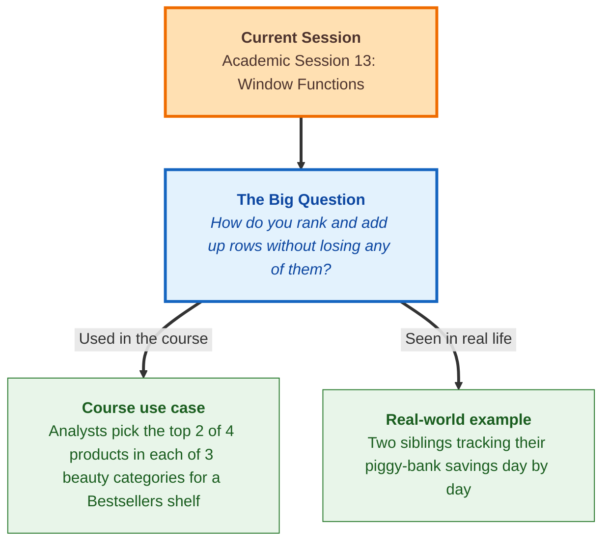

## <span style="color:#2F7DDE">Academic Session 13: Window Functions</span>

### <span style="color:#2F7DDE">Mental Map</span>



---

### <span style="color:#2F7DDE">What You'll Learn</span>

Have you ever wondered how a savings app shows your total so far beside every single deposit?

By the end of this session, you will be able to:

- <span style="color:#D9660B">**Describe**</span> how one total per child differs from a list that keeps all 6 savings days.
- <span style="color:#D9660B">**Calculate**</span> the savings so far for Anya after each of her 3 days.
- <span style="color:#D9660B">**Determine**</span> the order of each child's days, from biggest saving to smallest.
- <span style="color:#D9660B">**Compare**</span> ranking all 6 days together with ranking each child's days on their own.
- <span style="color:#D9660B">**Plan**</span> a way to find each child's single best saving day.

> <span style="color:#2F7DDE">**Topics you will meet:**</span> window functions, ROW_NUMBER, RANK, PARTITION BY, running totals and top items per group.
>
> Join the session to learn each of these in detail.

---

### <span style="color:#2F7DDE">Why You Are Learning This Topic</span>

Anya and Rohan each keep a piggy bank. Every evening, they note down the coins they saved that day. Their parent asks two questions. How much has each child saved so far? And what was each child's best day? A single total per child answers neither, because the daily amounts disappear.

A <span style="color:#D9660B">**window function**</span> means a calculation over a group of rows that still keeps every row.

In your course, you will use the same idea to pick the top products in each category.

> <span style="color:#2F7DDE">**Think about it:**</span> Why does one total per child hide the best day?

---

### <span style="color:#2F7DDE">The Piggy Bank Puzzle</span>

Here is the savings diary for the first 3 days.

| Child | Day | Saved (₹) |
|:-----:|:---:|:---------:|
| Anya | 1 | 20 |
| Anya | 2 | 30 |
| Anya | 3 | 10 |
| Rohan | 1 | 40 |
| Rohan | 2 | 10 |
| Rohan | 3 | 20 |

<span style="color:#D9660B">**What you want to happen:**</span>

- Keep all 6 rows on the page.
- Show each child's savings so far beside every day.
- Mark each child's best day with a 1.

Here is how it might start. You do not need to understand it yet.

```sql
SELECT child, day_no, amount,
       SUM(amount) OVER (PARTITION BY child ORDER BY day_no) AS saved_so_far
FROM savings;
```

> <span style="color:#D9660B">**Wonder about this:**</span>
>
> - Why does the total start again from zero for Rohan?
> - What should happen if a child saved the same amount on two days?

---

### <span style="color:#2F7DDE">Think It Through</span>

There is no wrong first try. Keep your guesses for the session.

**1. How much has Rohan saved by the end of day 2?**
Hint: Add his day 1 and day 2 amounts.

**2. Which was each child's best saving day?**
Hint: Look at one child's rows at a time.

**3. If you rank all 6 days together, who owns the top two days?**
Hint: Sort all six amounts from biggest to smallest.

---

### <span style="color:#2F7DDE">One Question to Carry Into the Session</span>

> <span style="color:#2F7DDE">**How can a query add up or rank rows while still showing every row?**</span>
>
> And how do you make it start again for each child?
